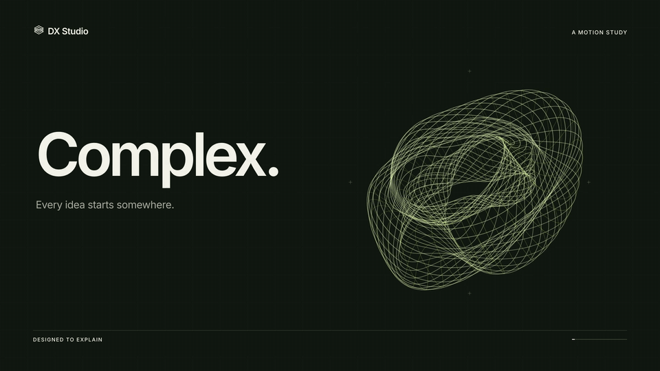
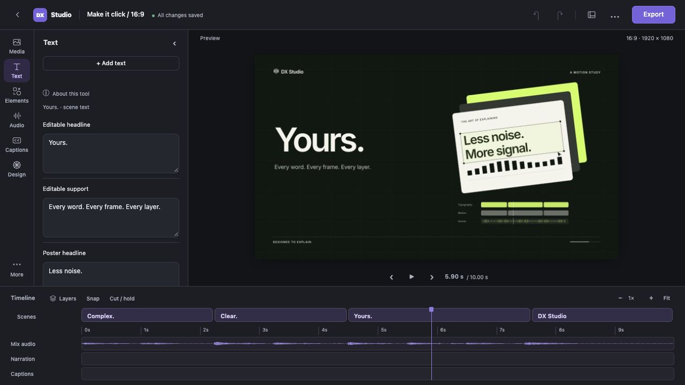
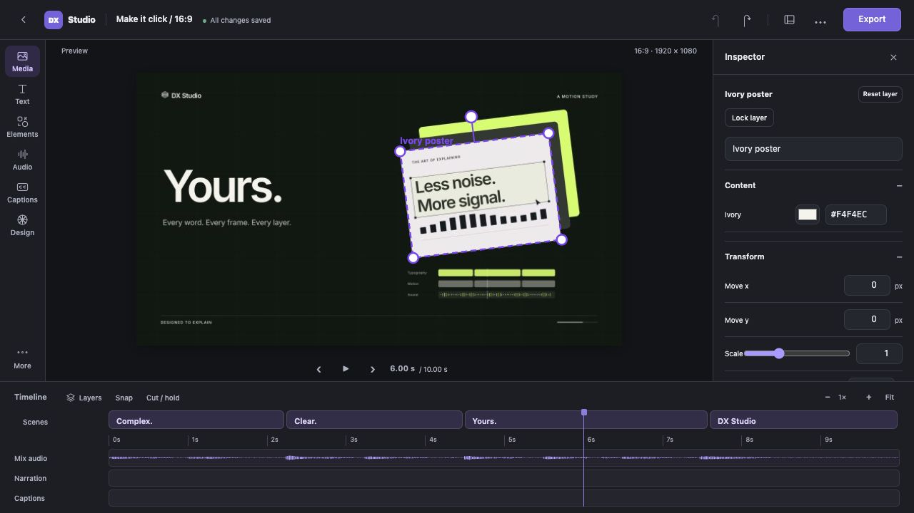
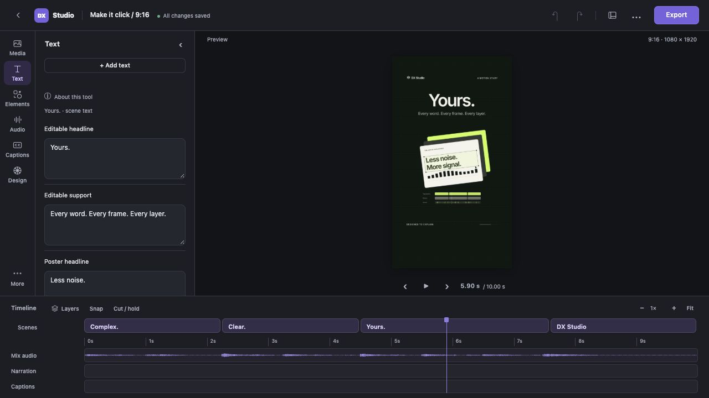
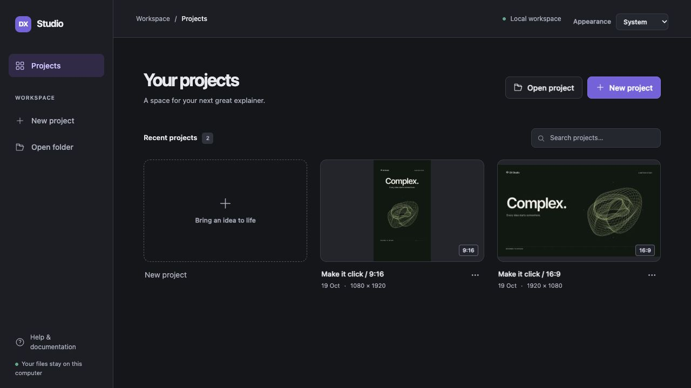
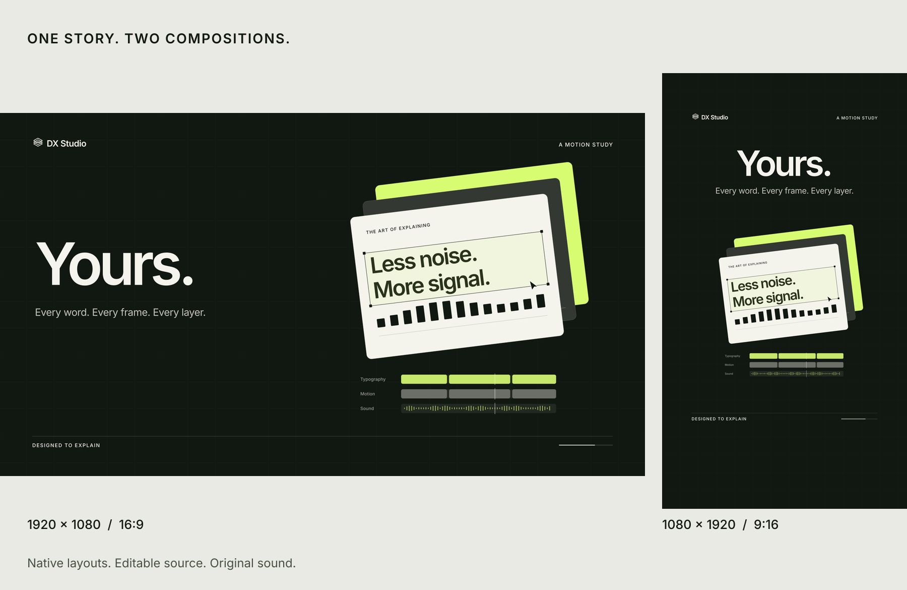
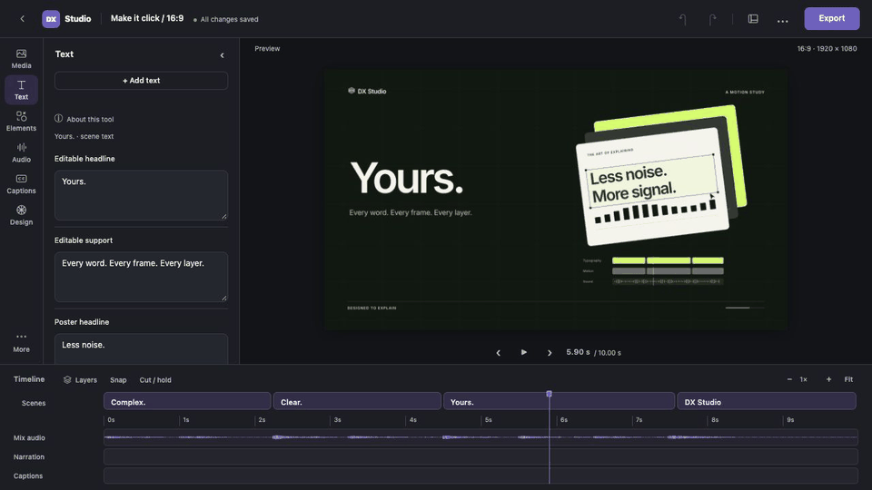

<h1 align="center">DX Studio</h1>
<p align="center"><b>Turn a brief into an explainer video you can still edit.</b><br>Write with Claude, ChatGPT or a coding assistant. Finish in DX Editor.<br>DX stands for DesignXstream.</p>
<p align="center">MIT code · Python 3.10+ · 9:16 and 16:9 · Local editor · No API key required</p>
<p align="center"><a href="#a-look-around">Explore the editor</a> · <a href="#made-with-dx-studio">See it in action</a> · <a href="#features">Features</a> · <a href="#create-with-your-assistant">Use the skill</a> · <a href="#get-started">Get started</a></p>

<p align="center">
  <a href="https://github.com/joyjophin/dx-studio/releases/download/v1.0.0/make-it-click-landscape.mp4"></a>
  <br><sub><b>Make it click.</b> Ten seconds. Original motion and sound. Made entirely with DX Studio.</sub>
</p>
<p align="center"><a href="https://github.com/joyjophin/dx-studio/releases/download/v1.0.0/make-it-click-landscape.mp4">Watch 16:9 with sound</a> · <a href="https://github.com/joyjophin/dx-studio/releases/download/v1.0.0/make-it-click-portrait.mp4">Watch 9:16 with sound</a> · <a href="examples/showcase/README.md">Open the editable projects</a></p>

An AI-generated video often arrives as a finished file. DX Studio gives you the
**project as well as the MP4**. Change a caption, hide a graphic, move a layer or
adjust the timing in DX Editor, then rebuild from the same source.

<table>
<tr>
<td width="25%" valign="top"><h3>Make it with AI</h3>A focused skill for scripting, visual explanations, pacing and an editable handoff. Use the assistant and coding environment you prefer.</td>
<td width="25%" valign="top"><h3>Finish it yourself</h3>Click a layer and change its words, position, scale, visibility or timing. Add text, shapes, images and footage.</td>
<td width="25%" valign="top"><h3>Leave room for you</h3>Reserve a corner, a half-frame or a bottom band for your talking head. Included templates reflow graphics and captions.</td>
<td width="25%" valign="top"><h3>Keep the source</h3>Your scene, assets and saved edits live in a folder. Portable bundles include the matching engine source.</td>
</tr>
</table>

**DX Studio v1.0** is the first full product launch. It includes
[project home and bulk editing](docs/WORKSPACE.md), [media](docs/MEDIA.md),
[narration](docs/NARRATION.md), [audio balance](docs/AUDIO_WORKSPACE.md),
[captions](docs/CAPTIONS.md), [brand presets](docs/BRAND_PRESETS.md),
[workspace controls](docs/VIEW.md) and [cancellable exports](docs/EXPORTS.md).
Visual clips support source-aware trim/split, saved selection groups and reviewed
folder recovery. Project downloads include an integrity manifest and matching
engine, with older settings versions available as an opt-in backup. Preview
caches are bounded; footage decodes in four-second sections.
Layer finishing also includes [reusable motion styles, stagger and editable easing curves](docs/MOTION.md).

The new [creator workflow](docs/CREATOR_WORKFLOW.md) adds correctable word timings,
aligned captions, reviewed narration-linked retiming, storyboard playback order,
protected assistant revisions with frame comparisons, actual presenter clips and
scene layouts, editable explanation blocks, portable fonts/logos/templates and
range exports with profiles, SRT and sampled quality review. Speech recognition is
optional; timed-word import needs no model or account.
[Download v1.0](https://github.com/joyjophin/dx-studio/releases/tag/v1.0.0) ·
[First project](docs/QUICKSTART.md) · [What changed](CHANGELOG.md).

## A look around

A focused canvas, scene text on the left and a timeline below. Select a layer
when you need its position, scale, timing or motion controls. Light and dark
appearances follow your system, with a preference to choose either.
There is no chat or prompt panel. [Workspace preferences →](docs/VIEW.md)

<p align="center">
  
  <br><sub><b>The film, still editable.</b> Real editor capture with the showcase project open.</sub>
</p>

<table>
<tr>
<td width="50%" valign="top">
  
  <p><b>Work at the layer level.</b> The poster's typography and graphics move with their parent. Keep each detail independently editable.</p>
</td>
<td width="50%" valign="top">
  
  <p><b>Compose for the format.</b> Portrait has its own geometry, spacing and type hierarchy. It is not a crop of the landscape film.</p>
</td>
</tr>
</table>

<p align="center"></p>

Project cards keep your work within reach. Open a folder from your assistant,
continue a recent project, or begin with an editable template.
[Editor layout →](docs/EDITOR_LAYOUT.md) · [Recreate these captures →](docs/GALLERY.md)

## Made with DX Studio

**Make it click** is an original ten-second motion study: complexity becomes
clarity, then something you can make your own. The ribbon mesh, moving colour
mattes, typography, poster planes and sound are produced locally. All visible
words and palette colours remain parameters; the artwork uses selectable layers.

<p align="center">
  
</p>

[Landscape MP4 + sound](https://github.com/joyjophin/dx-studio/releases/download/v1.0.0/make-it-click-landscape.mp4) ·
[Portrait MP4 + sound](https://github.com/joyjophin/dx-studio/releases/download/v1.0.0/make-it-click-portrait.mp4) ·
[Editable landscape bundle](https://github.com/joyjophin/dx-studio/releases/download/v1.0.0/make-it-click-landscape-project.zip) ·
[Editable portrait bundle](https://github.com/joyjophin/dx-studio/releases/download/v1.0.0/make-it-click-portrait-project.zip)

<details>
<summary><b>See a real headline edit</b></summary>



Actual editor captures, held for comparison. Change the words in **Text**;
the scene renderer updates the preview. This comparison is silent.

</details>

The demo's code, graphics and synthesised audio are original and MIT licensed;
DX Sans uses the SIL Open Font License. No character pack, stock footage, voice
model or API key is needed. The film contains illustrative track graphics, while
the editor images above are genuine UI captures.
[Art direction, source and render instructions →](examples/showcase/README.md)

Start a new film with the [explainer](dx_studio/templates/explainer/scene.py)
or [minimal starter](dx_studio/templates/starter/scene.py), or customise the showcase.

## Features

<table>
<tr>
<td width="50%" valign="top"><h3>Text and captions you can change</h3>Typed scene parameters expose headlines, labels, colours and cue times. Caption phrases have their own words, highlight and timing. Bundled font outlines keep text independent of installed system fonts.</td>
<td width="50%" valign="top"><h3>Layers with real controls</h3>Select elements on the preview. Move, scale, rotate, fade, hide and reorder them. Retime their bars, add keyframes, or choose entrance and exit presets. Layer-linked sounds follow timing and visibility edits.</td>
</tr>
<tr>
<td width="50%" valign="top"><h3>Composition that leaves space</h3>Choose portrait or landscape and a presenter reservation. The supplied templates recalculate graphics, caption placement and selection boxes. Custom scenes can use the same <code>project.layout</code> geometry.</td>
<td width="50%" valign="top"><h3>Voice, music and sound</h3>Import and replace voice takes, trim sources, set timing and relative levels, mute takes, or use optional local speech tools. Mix synthesised sound effects and music, duck the bed under speech, and master to configurable loudness and peak targets.</td>
</tr>
<tr>
<td width="50%" valign="top"><h3>Your assets and visual identity</h3>Import images, GIFs and footage, or add text and shapes in the editor. Supply a brand palette and your own licensed stickers. The public templates have no dependency on personal artwork.</td>
<td width="50%" valign="top"><h3>A handoff that keeps your edits</h3>Save changes in <code>settings.json</code> without overwriting the scene defaults. Pack the project, source assets, saved edits and matching engine into a portable zip. Caches and output videos stay out of the bundle.</td>
</tr>
</table>

[Customisation](docs/CUSTOMIZE.md) · [Presenter layouts](reference/PRESENTER_LAYOUTS.md) · [Asset replacement](docs/ASSETS.md)

## Create with your assistant

Give the assistant [SKILL.md](SKILL.md), or use the `dx-studio-video.zip` skill bundle
from a release. The skill supports hooks, visual proof, narration, caption pacing,
render checks and a project you can finish in the editor.

> Use the DX Studio skill to make a 40-second landscape explainer about why password
> managers help. Leave the left half clear for my talking head. Show a concrete
> before/after example, keep the words and graphics editable, and deliver the MP4
> plus a project I can open in DX Editor.

```text
Brief → script and beats → editable project → DX Editor → final MP4
                              ↑                 ↓
                              └── saved edits ──┘
```

The skill asks about presenter placement when it is not already specified. It
works with assistants that can run Python, access files and inspect images.
Text-only chat can draft source; rendering needs a coding environment. Story
craft can help attention and understanding; it cannot guarantee views.

## Get started

Download the **source ZIP** from [the v1.0 release](https://github.com/joyjophin/dx-studio/releases/tag/v1.0.0), extract it, and follow the [platform setup guide](docs/INSTALL.md) for Python, Cairo and FFmpeg. Then:

- **macOS:** open **Launch DX Studio.command**.
- **Linux / WSL2:** run `bash launch.sh` inside the extracted folder.

The launcher creates a local environment, installs Python dependencies on first
setup, checks the installation and opens your projects dashboard. Try the editable
sample or create your own project. Nothing needs a paid API or voice model.

For an existing Python environment, the manual path is:

```sh
python3 -m venv .venv
source .venv/bin/activate
python -m pip install -e .
python -m dx_studio doctor
python -m dx_studio init projects/hello --format 16:9
python -m dx_studio edit projects/hello
```

Edits autosave. Choose **Export → Build this export** to create the MP4.
For portrait, choose `--format 9:16`. To reserve presenter space:

```sh
python -m dx_studio init projects/lesson --format 16:9 --presenter left-half
```

Choose `none`, `bottom-left`, `bottom-right`, `left-half`, `right-half` or
`bottom-band`. You can change the choice in **Presenter layout → Composition**.

[macOS, Linux and WSL setup →](docs/INSTALL.md)

<details>
<summary><b>Render, inspect and share from the command line</b></summary>

```sh
python -m dx_studio check projects/hello
python -m dx_studio still projects/hello 1 5 9 13
python -m dx_studio build projects/hello
python -m dx_studio pack projects/hello --output outputs/hello-project.zip
```

`dx-studio` is also installed as a command. Extract a project bundle and follow
its OPEN-ME.md to install the matching engine and open the project.

</details>

## Under the hood

One project folder connects the assistant, renderer and editor:

```text
my-video/
  project.json       format, narration, music and composition
  scene.py           typed parameters, layers and animation
  captions.json      caption phrases and timing, when used
  settings.json      the creator's saved changes, when present
  assets/            source images, footage and optional stickers
  vo/                narration files, when used
```

Cairo draws frames, HarfBuzz shapes text, and FFmpeg exports H.264/AAC. Preview
and export use the same scene renderer. Stable layer IDs preserve the relationship
between scene defaults and saved edits when an assistant revises a project.

[Architecture](docs/ARCHITECTURE.md) · [Scene contract](reference/PROJECT_FORMAT.md) · [API](reference/API.md)

## Status and contributing

**1.0.0 is the first full product launch.** Earlier 0.x releases remain available.
[Release validation and measured limits](docs/VALIDATION.md) describe what was
checked. Ubuntu CI covers Python 3.10 and 3.13; macOS validation uses an arm64 Mac.
WSL2 follows Ubuntu setup but has not received a separate launch validation pass.

The renderer uses the CPU. Hosted collaboration, GPU rendering, automatic
reframing of arbitrary scenes and broad multilingual coverage are future work.
Native Windows is not validated; use WSL2. The included templates support
presenter reflow; custom scenes must implement the layout contract. Manual layer
edits can still cross safe-zone guides and need a final review.

Scene files execute Python: open projects from people you trust.
[Security](SECURITY.md) · [Contributing](CONTRIBUTING.md) · [Roadmap](docs/ROADMAP.md) · [Changelog](CHANGELOG.md)

## Licence and credits

Code and original documentation: [MIT](LICENSE). Bundled fonts: SIL OFL 1.1.
Imported assets and optional speech models keep their own licences.
[Third-party notices](THIRD_PARTY_NOTICES.md).

Created by **Jophin Joy / DesignXstream**. Make the story. Keep the layers.
