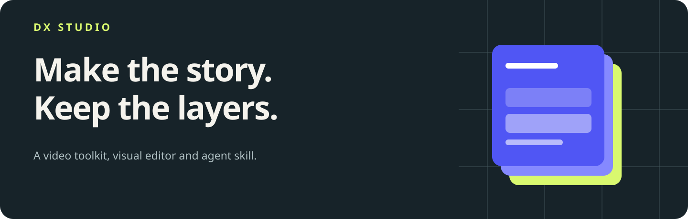
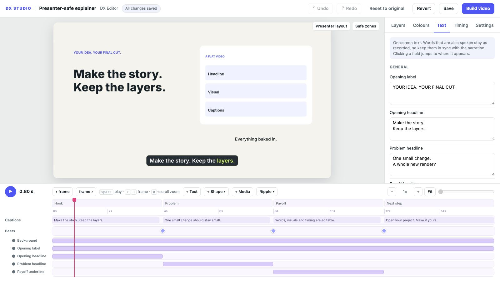
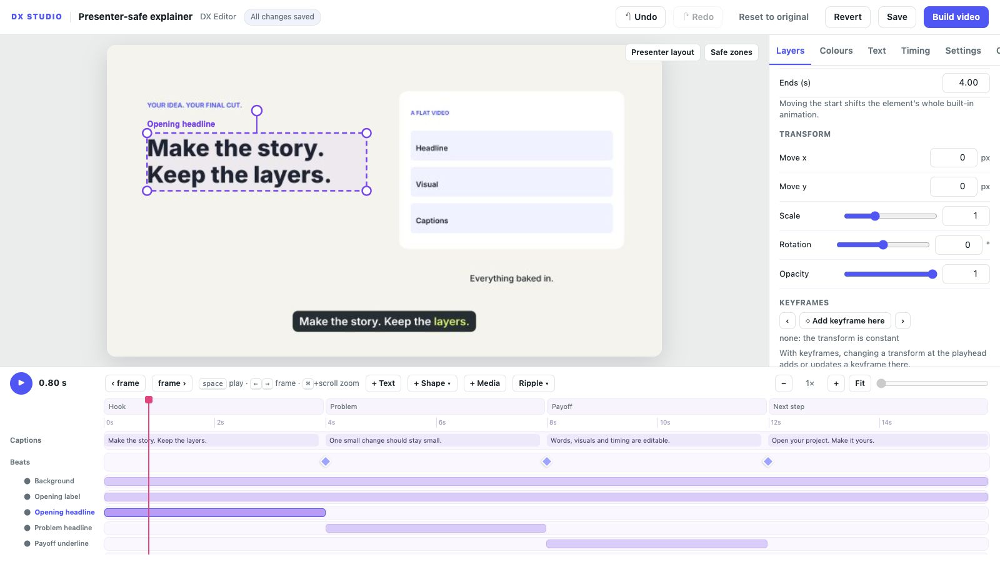
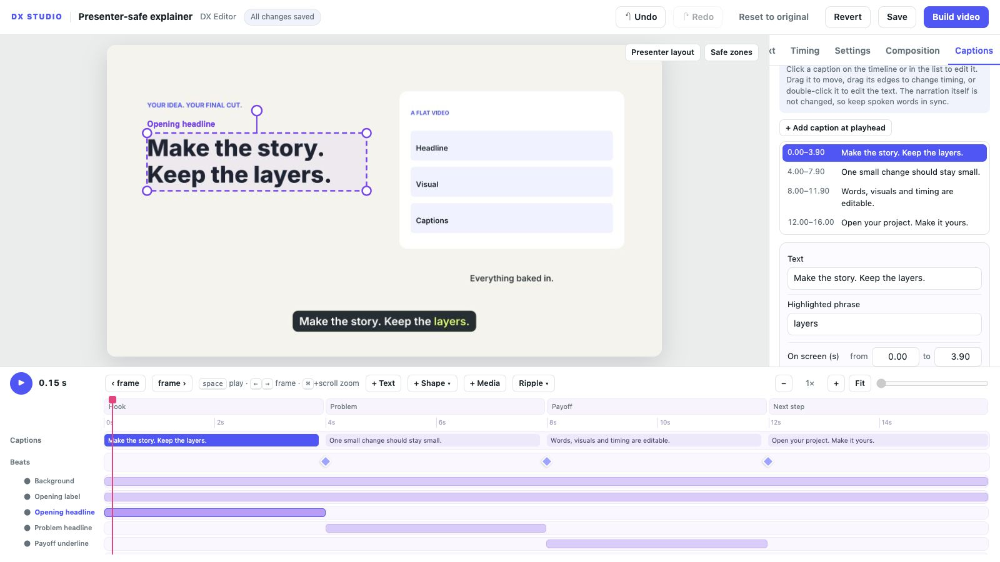
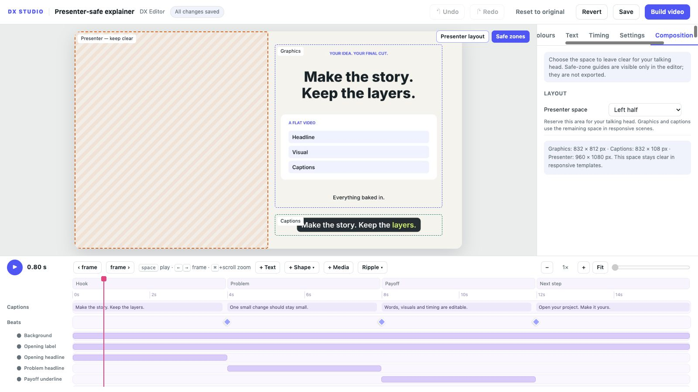
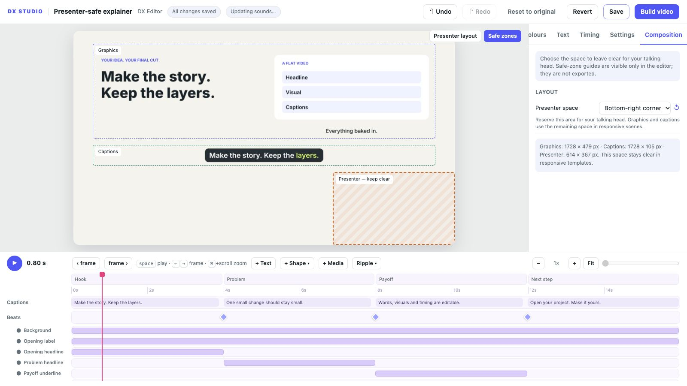
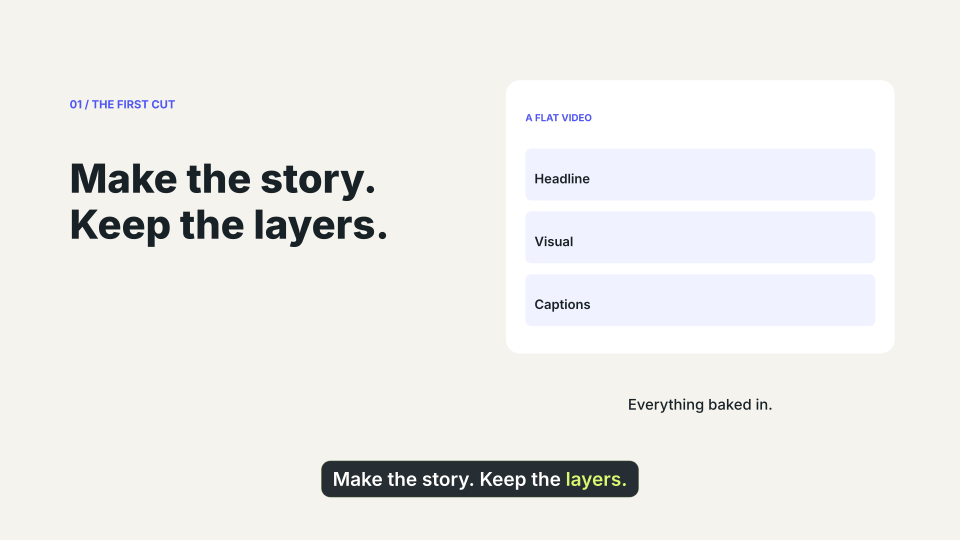
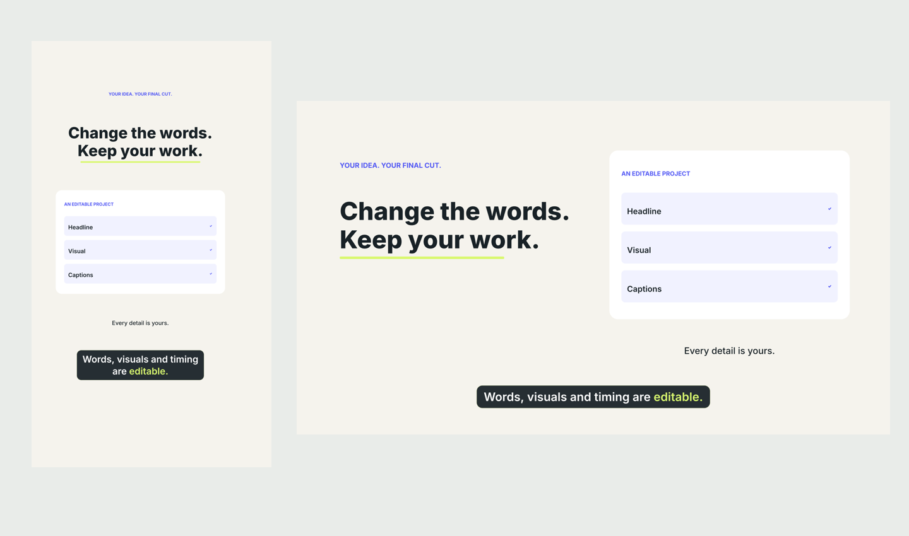

<p align="center"></p>

<h1 align="center">DX Studio</h1>
<p align="center"><b>Turn a brief into an explainer video you can still edit.</b><br>Write with Claude, ChatGPT or a coding assistant. Finish in DX Editor.<br>DX stands for DesignXstream.</p>
<p align="center">MIT code · Python 3.10+ · 9:16 and 16:9 · Local editor · No API key required</p>
<p align="center"><a href="#a-look-around">Explore the editor</a> · <a href="#made-with-dx-studio">See it in action</a> · <a href="#features">Features</a> · <a href="#create-with-your-assistant">Use the skill</a> · <a href="#get-started">Get started</a></p>

<p align="center">
  
  <br><sub><b>A video, with its working parts.</b> Real editor capture, 1600 × 900. The included explainer stays editable as text, colours, captions and layers.</sub>
</p>

An AI-generated video often arrives as a finished file. DX Studio gives you the
**project as well as the MP4**. Change a caption, hide a graphic, move a layer or
adjust the timing in DX Editor, then rebuild from the same source.

<table>
<tr>
<td width="25%" valign="top"><h3>Make it with AI</h3>A focused skill for scripting, visual explanations, pacing and an editable handoff. Use the assistant and coding environment you prefer.</td>
<td width="25%" valign="top"><h3>Finish it yourself</h3>Click a layer and change its words, position, scale, visibility or timing. Add text, shapes, images and footage.</td>
<td width="25%" valign="top"><h3>Leave room for you</h3>Reserve a corner, a half-frame or a bottom band for your talking head. Included templates reflow graphics and captions.</td>
<td width="25%" valign="top"><h3>Keep the source</h3>Your scene, assets and saved edits live in a folder. Portable bundles include the matching engine source.</td>
</tr>
</table>

## A look around

<table>
<tr>
<td width="50%" valign="top">
  
  <p><b>Move, scale, hide and animate.</b> Each declared layer has its own controls and timeline bar.</p>
</td>
<td width="50%" valign="top">
  
  <p><b>Fix the words that matter.</b> Edit caption text, its highlight and its timing while keeping the narration as recorded.</p>
</td>
</tr>
<tr>
<td width="50%" valign="top">
  
  <p><b>A whole half for your presenter.</b> Put the explanation on the opposite side, with a separate caption band.</p>
</td>
<td width="50%" valign="top">
  
  <p><b>Or keep a corner clear.</b> Bottom-left, bottom-right and a vertical bottom band are built in. Guides stay out of the export.</p>
</td>
</tr>
</table>

These are captures of the working editor. [Recreate the examples and gallery →](docs/GALLERY.md)

## Made with DX Studio

<p align="center">
  
  <br><sub><b>One project. Four small edits.</b> Original → change the headline → change the accent → hide a layer. These frames come from the actual renderer; the loop has no audio.</sub>
</p>

<p align="center">
  
  <br><sub><b>Portrait and landscape, deliberately composed.</b> The explainer template renders native 1080 × 1920 or 1920 × 1080 frames.</sub>
</p>

Start from the [explainer source](dx_studio/templates/explainer/scene.py) or the
[minimal starter](dx_studio/templates/starter/scene.py). Both work without a voice
model, account, character pack or network request after installation.
[Render this demonstration yourself →](docs/GALLERY.md#render-the-editing-loop)

## Features

<table>
<tr>
<td width="50%" valign="top"><h3>Text and captions you can change</h3>Typed scene parameters expose headlines, labels, colours and cue times. Caption phrases have their own words, highlight and timing. Bundled font outlines keep text independent of installed system fonts.</td>
<td width="50%" valign="top"><h3>Layers with real controls</h3>Select elements on the preview. Move, scale, rotate, fade, hide and reorder them. Retime their bars, add keyframes, or choose entrance and exit presets. Layer-linked sounds follow timing and visibility edits.</td>
</tr>
<tr>
<td width="50%" valign="top"><h3>Composition that leaves space</h3>Choose portrait or landscape and a presenter reservation. The supplied templates recalculate graphics, caption placement and selection boxes. Custom scenes can use the same <code>project.layout</code> geometry.</td>
<td width="50%" valign="top"><h3>Voice, music and sound</h3>Use recorded narration, optional local speech tools, or no voice. Mix synthesised sound effects and music, duck the bed under speech, and master to configurable loudness and peak targets.</td>
</tr>
<tr>
<td width="50%" valign="top"><h3>Your assets and visual identity</h3>Import images, GIFs and footage, or add text and shapes in the editor. Supply a brand palette and your own licensed stickers. The public templates have no dependency on personal artwork.</td>
<td width="50%" valign="top"><h3>A handoff that keeps your edits</h3>Save changes in <code>settings.json</code> without overwriting the scene defaults. Pack the project, source assets, saved edits and matching engine into a portable zip. Caches and output videos stay out of the bundle.</td>
</tr>
</table>

[Customisation](docs/CUSTOMIZE.md) · [Presenter layouts](reference/PRESENTER_LAYOUTS.md) · [Asset replacement](docs/ASSETS.md)

## Create with your assistant

Give the assistant [SKILL.md](SKILL.md), or use the `dx-studio-video.zip` skill bundle
from a release. The skill supports hooks, visual proof, narration, caption pacing,
render checks and a project you can finish in the editor.

> Use the DX Studio skill to make a 40-second landscape explainer about why password
> managers help. Leave the left half clear for my talking head. Show a concrete
> before/after example, keep the words and graphics editable, and deliver the MP4
> plus a project I can open in DX Editor.

```text
Brief → script and beats → editable project → DX Editor → final MP4
                              ↑                 ↓
                              └── saved edits ──┘
```

The skill asks about presenter placement when it is not already specified. It
works with assistants that can run Python, access files and inspect images.
Text-only chat can draft source; rendering needs a coding environment. Story
craft can help attention and understanding; it cannot guarantee views.

## Get started

Install [Python, Cairo and FFmpeg](docs/INSTALL.md), then run from the extracted or
cloned repository:

```sh
python3 -m venv .venv
source .venv/bin/activate
python -m pip install -e .
python -m dx_studio doctor
python -m dx_studio init projects/hello --format 16:9
python -m dx_studio edit projects/hello
```

DX Editor opens locally. Change something, press **Save**, then **Build video**.
For portrait, choose `--format 9:16`. To reserve presenter space:

```sh
python -m dx_studio init projects/lesson --format 16:9 --presenter left-half
```

Choose `none`, `bottom-left`, `bottom-right`, `left-half`, `right-half` or
`bottom-band`. You can change the choice in **Presenter layout → Composition**.

[macOS, Linux and WSL setup →](docs/INSTALL.md)

<details>
<summary><b>Render, inspect and share from the command line</b></summary>

```sh
python -m dx_studio check projects/hello
python -m dx_studio still projects/hello 1 5 9 13
python -m dx_studio build projects/hello
python -m dx_studio pack projects/hello --output outputs/hello-project.zip
```

`dx-studio` is also installed as a command. Extract a project bundle and follow
its OPEN-ME.md to install the matching engine and open the project.

</details>

## Under the hood

One project folder connects the assistant, renderer and editor:

```text
my-video/
  project.json       format, narration, music and composition
  scene.py           typed parameters, layers and animation
  captions.json      caption phrases and timing, when used
  settings.json      the creator's saved changes, when present
  assets/            source images, footage and optional stickers
  vo/                narration files, when used
```

Cairo draws frames, HarfBuzz shapes text, and FFmpeg exports H.264/AAC. Preview
and export use the same scene renderer. Stable layer IDs preserve the relationship
between scene defaults and saved edits when an assistant revises a project.

[Architecture](docs/ARCHITECTURE.md) · [Scene contract](reference/PROJECT_FORMAT.md) · [API](reference/API.md)

## Status and contributing

**0.1.0 is the first public release.** The local renderer/editor workflow has
[documented validation](docs/VALIDATION.md), including 72 passing regression tests
and full-HD export checks. GitHub Actions runs after the repository is uploaded.

The renderer uses the CPU. Hosted collaboration, GPU rendering, automatic
reframing of arbitrary scenes and broad multilingual coverage are future work.
Native Windows is not validated; use WSL2. The included templates support
presenter reflow; custom scenes must implement the layout contract. Manual layer
edits can still cross safe-zone guides and need a final review.

Scene files execute Python: open projects from people you trust.
[Security](SECURITY.md) · [Contributing](CONTRIBUTING.md) · [Roadmap](docs/ROADMAP.md) · [Changelog](CHANGELOG.md)

## Licence and credits

Code and original documentation: [MIT](LICENSE). Bundled fonts: SIL OFL 1.1.
Imported assets and optional speech models keep their own licences.
[Third-party notices](THIRD_PARTY_NOTICES.md).

Created by **Jophin Joy / DesignXstream**. Make the story. Keep the layers.
