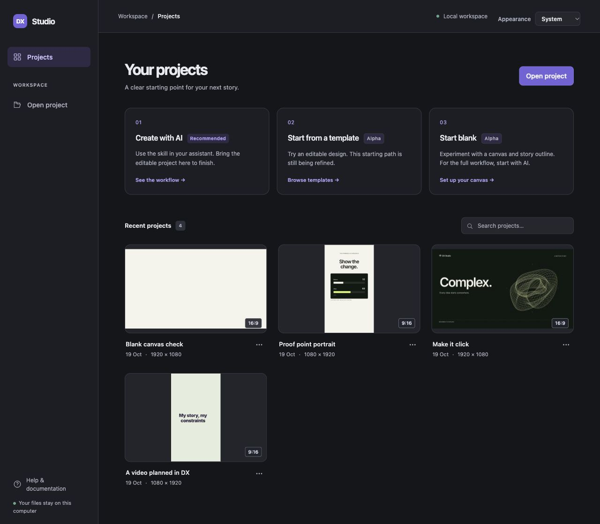
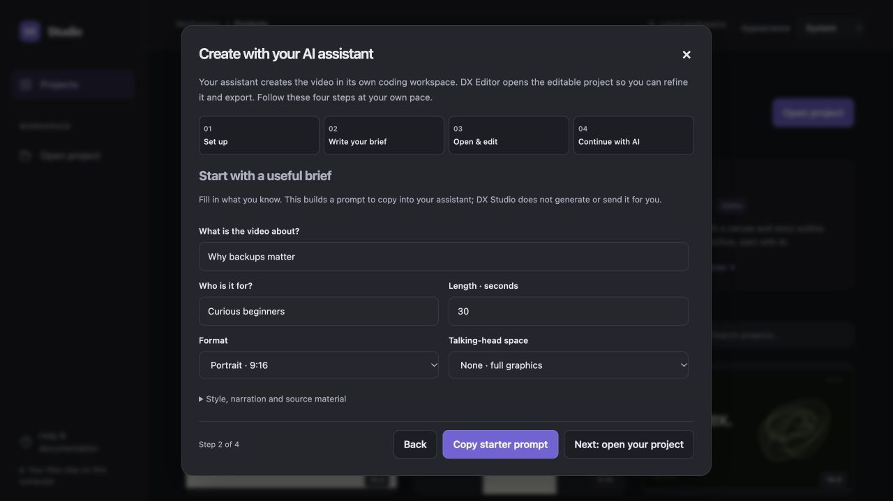
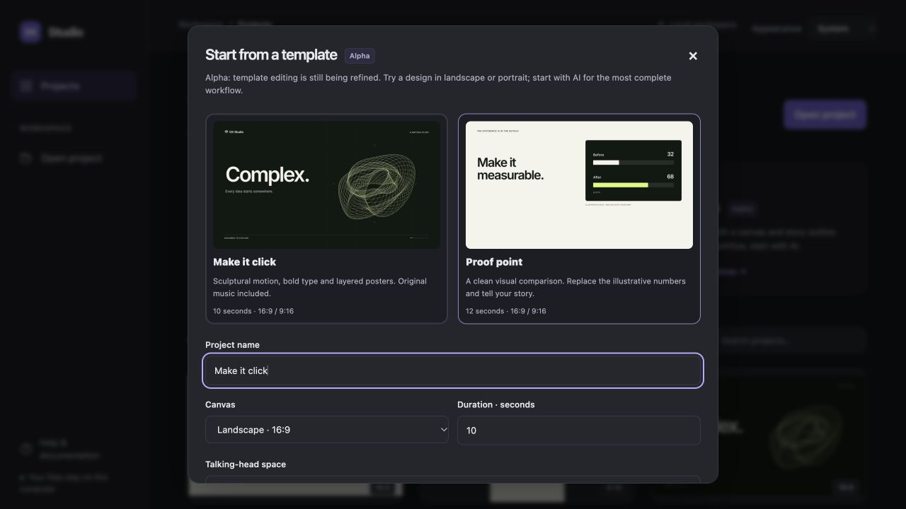

# Three ways to start, one editable project

DX Studio connects an external AI assistant and a local visual editor through a
project folder. It does not send prompts to a provider or connect to a chat account.

| Start | Use it when | Next step |
| --- | --- | --- |
| **Create with AI** | You want your assistant to make the video from a brief | Open the returned editable project folder |
| **Start from a template** | You want a finished visual starting point | Choose Make it click or Proof point, then edit |
| **Start blank** | You want to set the constraints and outline first | Add titles/storyboard notes, then prepare an AI handoff |



**Recommended for launch: Create with AI.** Template and blank-project starts are
**Alpha**: available to experiment with, while their authoring experience is still
being refined. Alpha describes these two starting paths, not the project file format.

## 1. Create with AI, then keep the same chat

Download the repository or release, install DX Studio using [INSTALL](INSTALL.md),
and give your assistant the release's `dx-studio-video.zip` or repository
[SKILL.md](../SKILL.md). Skill installation differs by assistant; loading a Markdown
file is context, not permission to read your computer. Use an environment that can
run Python, inspect images and access a folder you explicitly share with it.

Choose **Create with AI** on the dashboard for the four-step walkthrough:

1. **Set up:** download the skill ZIP, keep its resources together, and share it
   with an assistant that has coding tools and access to a project folder. Skill
   installation follows the assistant's own setup; otherwise ask it to read SKILL.md.
2. **Write your brief:** enter the topic, audience, duration, format and presenter
   space. Optional style/source choices build an editable starter prompt. Copy it
   into your assistant; DX does not generate a video or submit the prompt itself.
3. **Open & edit:** request an editable folder, MP4 and portable project ZIP. Open
   the folder containing project.json, not an MP4 or ZIP. The walkthrough explains
   extraction, matching-engine setup, basic editor changes and export.
4. **Continue with AI:** keep the same chat, prepare the editor handoff, then review
   source updates. Use the JSON plus portable ZIP when folders are not shared.



The steps are navigation, not automatic checks of assistant installation or video
completion. Your typed brief stays in the dialog during this visit; it is not sent
to a provider or saved as a project. Editing brief fields rebuilds the prompt.

Start with a concrete brief:

> Use the DX Studio skill to create a 45-second 9:16 explainer about password
> managers. Use my narration, centre the graphics and leave the bottom-right corner
> for my talking head. Deliver editable layers, an MP4 and a portable project ZIP.

Open the actual project folder with **Open project** on the dashboard. If your
assistant returns a portable ZIP, extract it first and follow its `OPEN-ME.md` to
install the matching engine; open the inner `project/` folder.

Make manual edits, wait for **All changes saved**, then choose **Continue with AI**.
Describe the next change and choose **Prepare AI handoff**. DX saves
`dx-ai-handoff.json` into the project and gives you a follow-up prompt to copy into
**the same chat**. This retains the creative conversation. Give that assistant
access to the same local folder so it can read the saved edits and revise the files.

DX detects changes to source, configuration, saved settings and referenced media.
Choose **Review file updates → Reload AI changes** after the assistant finishes.
Updates are deliberately reviewed; the editor does not execute revised scene code
silently. A failed source reload leaves the working preview available. Reload
clears the in-memory undo stack; saved settings versions and browser drafts remain.

If you have unsaved local edits when files change, saving pauses and a browser
draft is retained. Download the pending edits from the review dialog before
reloading, then review Recovery against the updated project. Do not blindly apply
an old draft over a revised scene.

A chat without local folder access cannot update the editor automatically. Attach
the JSON **and Download full project** ZIP, ask for an updated editable project,
and open its returned folder. A text-only assistant cannot verify a render.

## 2. Start from a template · Alpha

Choose **Start from a template** on the dashboard:

- **Make it click**: ten seconds of sculptural motion, bold typography, layered
  posters and original music.
- **Proof point**: a twelve-second editorial comparison with editable labels,
  values, colours and takeaway. Its example numbers are explicitly illustrative;
  replace them with your own evidence.

Both have native landscape and portrait compositions, selectable layers and
presenter reservations. Choose the format and camera space, then create the
project. Template durations preserve their authored choreography. You can retime
layers and scenes in the editor, or ask the assistant to adapt the story.

Edit words in **Text**, select canvas objects for transform/visibility controls,
and use the timeline for timing. Export an MP4, or use **Continue with AI** for
larger changes. Each template is copied into a new project; the original stays intact.



## 3. Start blank, then hand off your skeleton · Alpha

Choose **Start blank**, then set a name, canvas, duration and presenter reservation.
Presets include 16:9, 9:16 and square; custom even dimensions from 64 to 8192 pixels
are supported. Custom scenes must be composed for their chosen shape.

Add titles in **Text → + Add text** and set their timing. Use **Scenes** to name
beats and write story notes. Set presenter space in **Design → Layout**. You can
finish simple compositions manually, or choose **Continue with AI** and ask the
assistant to build around these decisions.

The JSON handoff carries the actual skeleton: dimensions, frame rate, source and
output durations, active layout rectangles, presenter reservations, storyboard,
editable title/media objects, layer IDs, protected decisions, effective settings,
media references and project text/source. It is not an MP4 or a flattened template.
The assistant should build in this folder and preserve your existing elements.

From the command line, the same handoff is available with:

```sh
python -m dx_studio init projects/outline --template blank --format 16:9 --duration 30 --presenter left-half
python -m dx_studio handoff projects/outline --request "Build around my titles and story notes"
```

Each prepared handoff also keeps a source/settings checkpoint in
`.dx-studio/ai-handoffs/`. It does not duplicate large media or the engine and is
not a complete backup. Use a portable project bundle for that.

## What leaves your computer

DX Studio sends nothing to an AI service. Copying a prompt or attaching a handoff
is your choice. The JSON includes local paths, project text, settings and source
code; inspect it before sharing. Binary media, fonts and the matching engine are
in the portable ZIP. Review unused/private files and licences before sending it.
