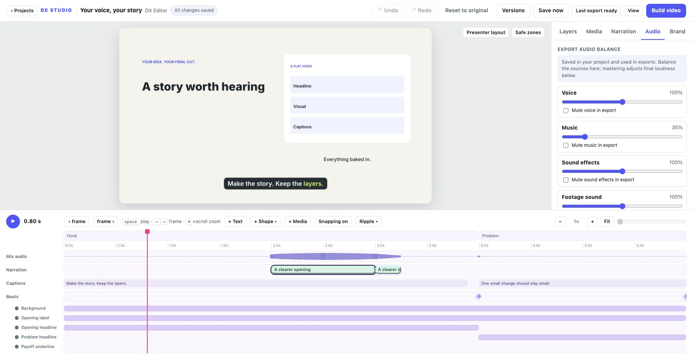
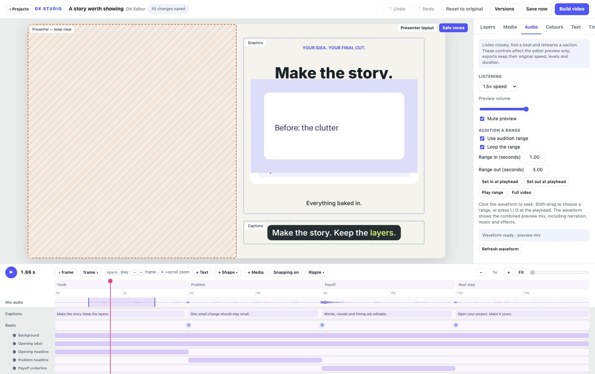

# Audio balance and preview listening

Available in the development source toward v0.5.0.

## Shape the exported mix

The top of **Audio** has saved balance and mute controls for voice, music, sound
effects and footage sound. Each balance runs from 0% to 200%; 100% keeps the
original mix. These are relative source balances before final mastering. A muted
voice track does not duck music. Muted voice/music sources do not block export
when their files are missing; unmute them to check or repair those sources.

Set a loudness target in LUFS and a true-peak ceiling in dBTP. Less-negative
loudness targets ask for a louder export. Mastering measures the result during
export; silence and very short clips may not reach the requested target. The
preview waveform and listening audio use the unmastered mix, so the mastering
target is heard in the finished video. Saved balance controls use normal undo,
autosave, versions, export snapshots and portable project bundles. **Reset export
balance** restores the project's original balances and mastering targets.

## Listen and rehearse

The **Mix audio** timeline lane shows the combined preview mix: narration,
footage sound, music and effects. Its timing follows the output timeline, including
ripple holds and cuts, because peaks are read from the generated preview mix.
Waveforms refresh after regenerated audio is ready. A missing or updating mix
shows a loading message; it does not stop silent visual preview.

Click or drag the waveform to seek. Focus it and use Left/Right for one frame,
or Shift+Left/Right for one second. Timeline zoom and scroll also apply to the
waveform. Shift-drag sets an audition range.

In **Audio → Preview listening**, choose 0.5× to 2× listening speed, adjust preview volume or mute
preview sound. Pitch preservation is requested from the browser. These controls
never change the saved mix or the exported video.

## Rehearse a small section

Set range in/out with the numeric fields, **Set in/out at playhead**, or I / O
while focus is outside text fields. **Play range** begins at the in point and
stops at the out point. Enable **Loop the range** to repeat it. **Use audition
range** also constrains normal playback; **Full video** clears the range.
Range boundaries stay within the video after timeline edits.

Ranges and listening choices last for this page session. They are audition tools,
not export trims or speed ramps. Individual voice-take waveforms, recording,
transcripts and separate music/effects track mixing remain planned. Imported
voice takes now have [their own saved controls](NARRATION.md).

Peak generation reads bounded chunks and caches up to eight versions per project.
Both stereo channels contribute to each peak, so opposite-polarity channels do
not cancel the display. Cache identity changes when the audio source changes.

