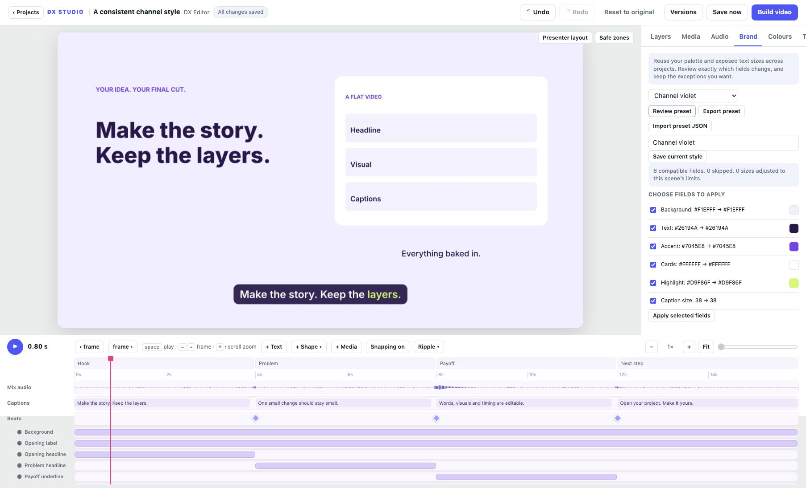

# Reusable brand presets

Open Design → Brand in the current tool rail.

For project-owned fonts/logos, portable brand ZIPs and selection templates, see [the creator workflow](CREATOR_WORKFLOW.md).

Available in DX Studio v1.0.

Open **Brand** to begin with Editorial paper, Electric violet or Midnight.
**Review preset** lists compatible fields, their current and proposed values,
and colour swatches. Uncheck fields that should keep their current values, then
choose **Apply selected fields**. Undo and autosave work normally. Text, timing,
media and individual layer transforms are preserved.

## Save your channel style

Adjust colours and exposed size settings in their normal panels. Enter a new
preset name and choose **Save current style**. The preset becomes available in
other projects opened from the same local project library. When a field review
is open, saving captures its checked compatible fields; otherwise it captures
all supported fields from the scene.

**Export preset** downloads portable JSON. **Import preset JSON** accepts an
exported preset by pasting its contents, saves it locally and opens a field
review before it changes the project. Existing names cannot be overwritten;
use a new name for a revised style.

Presets store public colour parameters as six-digit hex values and numeric
parameters ending in `_size`. Other scenes match by exact parameter key and
type. Missing fields are skipped and numeric values are constrained to the
scene's declared limits; the review reports both. This makes the result explicit
when custom scenes expose different controls.

The local library retains up to 100 named presets, with atomic writes and a
writer lock for concurrent editor processes. Applied values are saved in the
project settings, so portable project bundles retain the resulting style even
without the preset library.

Palette presets cover colours and exposed size settings. The same Brand workspace
also imports project-owned fonts and logos and exchanges portable brand ZIPs; see
the creator workflow linked above. Review text contrast, caption readability and
layout after a style change.
Layer locks guard direct editing; global colour parameters can still affect a
locked layer. Preset renaming/removal and broader inherited brand rules remain planned.

