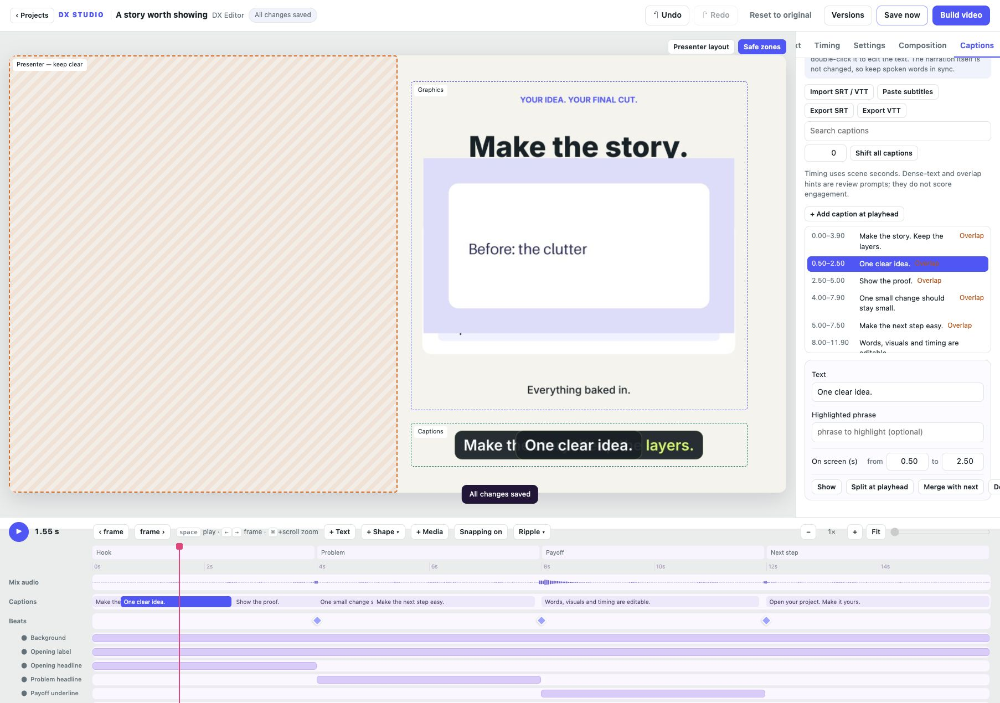

# Caption revision and interchange

Available in the development source toward v0.5.0, in projects exposing editable
captions (including the explainer template).

## Bring captions into the project

Use **Import SRT / VTT** for a local file, or **Paste subtitles** for text copied
from an assistant or transcription tool. Preview the parsed words and timings
before applying them. Choose whether the file refers to the current edited video
or the original scene timeline. You can add to existing captions or replace them.
Undo, autosave and setting versions apply normally. Import is limited to 1 MB and
2,000 cues at a time. The preview reports clipped or skipped cues.

Imports preserve text as plain words. Styling tags, cue settings, explicit line
breaks and embedded word timestamps are not retained; the scene controls layout
and phrase highlighting. This does not perform speech recognition or word alignment.

## Revise the phrases

Search the caption list. Select a phrase, place the playhead inside it and choose
**Split at playhead**. Words are divided proportionally at a word boundary; review
the result against your narration. **Merge with next** joins the next phrase in
time. Highlight phrases are retained where they still match.

**Shift all captions** applies a scene-time offset to the whole set. A shift that
would put any caption outside the scene is rejected without changing the set.
Text changes do not alter recorded narration.

Dense-text hints flag more than 20 characters per scene second. Overlap hints
identify phrases sharing time. These are review prompts rather than engagement
scores or universal reading-speed rules. Export preflight also warns about empty
captions and unmatched highlights, and blocks invalid timing. Findings link back
to the caption. Custom fonts, wrapping and actual on-screen readability still
need visual review.

## Deliver sidecar captions

**Export SRT** and **Export VTT** download the saved captions for the final edited
video. Exports account for ripple cuts and holds, including captions visible
while a frame is held. Fully removed cues are omitted. Files contain plain text;
animated highlights and styling stay in the rendered video.

From the command line:

```sh
dx-studio captions projects/my-video --format srt --output captions.srt
dx-studio captions projects/my-video --format vtt --output captions.vtt
```


