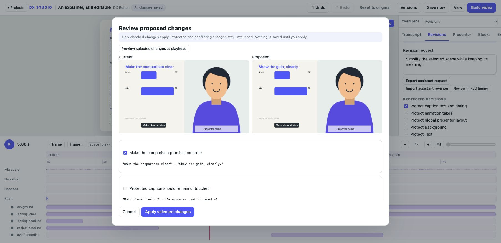

# Finish an explainer in DX Editor

These tools are available in the current **0.5.0.dev0 source**, alongside saving,
media, narration, audio balance and layer editing. Published v0.1 downloads remain
the initial release. Use the Workspace menu to switch between tools.

| Workspace | What you can finish |
| --- | --- |
| Transcript | Import or optionally transcribe word timings; correct names; click words; make aligned captions. |
| Revisions | Protect decisions, exchange settings patches with an assistant, compare frames and apply selected changes. |
| Storyboard | Name scenes, keep script/visual/source notes and change actual playback order. |
| Presenter | Place a recording, preserve its aspect ratio, crop/trim it and choose a layout per scene. |
| Blocks | Add editable comparisons, steps, quotes, CSV bar charts and title/sponsor cards. |
| Brand | Copy fonts and a logo into the project, keep rights notes and exchange a portable brand kit. |
| Blocks / templates | Save a selected set of editable layers with copied dependencies for another project. |
| Export | Set resolution/frame rate/caption mode, render a range and review frames, fonts and audio. |

## Work from the recording

Import voice in Narration, then use [Transcripts](TRANSCRIPTS.md) to build captions
and link a graphic to a real word. Replacing a take preserves its identity, trim,
timing and level; its old transcript becomes visibly stale until replaced. Review
proposed timing changes instead of rebuilding your manual decisions.

## Give the assistant a bounded revision

In Revisions, protect the selected layer, captions, narration, composition or public
parameters that should stay. Canvas locks also apply. Write the request and export
its JSON. The editor does not send it to an AI provider; share it with your chosen
assistant. It contains project values and notes, so inspect it before sharing.
Import the returned patch and inspect checked changes and Current/Proposed frames.
Conflicting values and protected targets cannot be applied. Apply rechecks the
current values and scene fingerprint. Undo or named setting versions can restore
a settings change. Python source changes require a separate source review.

See [the assistant contract](../reference/ASSISTANT_REVISIONS.md).

## Organize scenes

Storyboard cards start from project chapter boundaries, or the full project for a
scene without chapters. Script, visual and evidence notes are plain saved text.
Move earlier/later changes playback and exports for visuals, narration and captions.
The renderer retains each scene's original drawing clock and animation state.

Reorder **before** adding ripple cuts/holds. Reordering with later ripple edits is
blocked with an explanation; remove those edits first if a new order is needed.
After reordering, use numeric source-time controls for layers, captions and takes.
Timeline bars show each visible fragment. This first version does not split a custom
Python scene into independent source files or automatically create scene transitions.

## Place a presenter

Import a video path in Presenter, or choose an existing imported video. Select
cover (crop to fill) or contain (fit the whole image), crop focus, source trim,
corner radius, volume and mute. Choose full graphics, a lower corner, a half-frame
or a bottom band for each storyboard scene, or inherit the global layout.

A full-graphics scene hides the presenter image; its recording audio can continue.
The clip retains its source clock and holds its last available frame at the end.
This does not remove a background, sync a separate camera recording or generate
camera footage. The included templates reflow using `project.layout`; custom scene
code must opt into that layout contract. Guides stay out of the MP4.

## Make explanations from editable parts

Blocks create ordinary text and shape layers with a graphics-area backplate. Every
part can be selected, hidden, scaled, styled, keyframed or retimed. Comparisons use
two lines; steps use 2–6 lines; charts use 1–8 CSV rows such as `After,68`, with one
zero-inclusive scale supporting negative values. Keep data sources in attribution.

Choose an existing block to update its text/data. Manual transforms and animation
keys remain; locked/protected primitives retain their existing source. If you
change the reserved layout, update the block to regenerate its geometry for that
scene, then review manual transforms. These are five focused block types, not an
arbitrary node-based diagram editor.

Select complete block layers and save a named selection template. Complete blocks
retain their data model; partial selections become independent primitives. Template
JSON copies dependencies (20 MB total), includes brand references/credits and fits
uniformly within the target project's graphics rectangle. A landscape selection can
be inserted into portrait, but review readability and timing. Insertions retain
editable items and generate new IDs; optional template-brand application is explicit.
The local library holds up to 100 templates. Export JSON to back it up or share it.

## Bring your channel identity

Brand accepts local TTF/OTF paths and assigns headline, body/caption or all font
roles. Missing custom fonts fall back for repair and block export until resolved.
Import a logo, then add it as an ordinary editable image at the playhead. Neither
fonts nor logos require a proprietary pack. Keep licence/attribution notes and
redistribute only assets you may share. Brand ZIPs include declared font/logo files,
compatible palette/size tokens and credits; imports preview changes before applying.
Font support depends on the chosen font's glyph coverage.

## Export what you need

Export profiles retain the project's aspect ratio: source, 1080p (1920 long edge)
or 720p (1280 long edge). Choose project fps or 12/24/25/30/60. Higher fps samples
existing animation; it does not interpolate imported camera footage. A filename
must remain inside the project and cannot overwrite a source asset.

A range uses the **edited output clock**, independent of scene/word source time.
Use an explicit range or copy the audition range. Plain audition/solo still affects
preview only. Burned captions, a clean version or clean video with SRT are available
for engine-managed captions. Text drawn directly by custom scene code is unaffected.
SRT is clipped/rebased to the selected range, as is audio before mastering. A job
captures settings at launch. Video and its new sidecar publish only after success;
failure preserves the previous completed files. A prior SRT can remain after a
later burned/clean-only export: use the current job's sidecar link to identify a
newly generated subtitle file.

**Check source files** is the quick blocking preflight. **Review frames and audio**
runs in the background on a settings snapshot: up to 24 sampled frames, off-frame
bounds, presenter collisions, custom-font coverage and a fresh unmastered mix for
silence or clipping. Findings link to frames/layers; warnings can be dismissed and
restored, errors require a fix. Bounds can flag intentional crops. Review the final
video: this does not detect all overlaps, clipped text, story gaps or engagement
problems, and it is not a guarantee of quality or audience retention.
