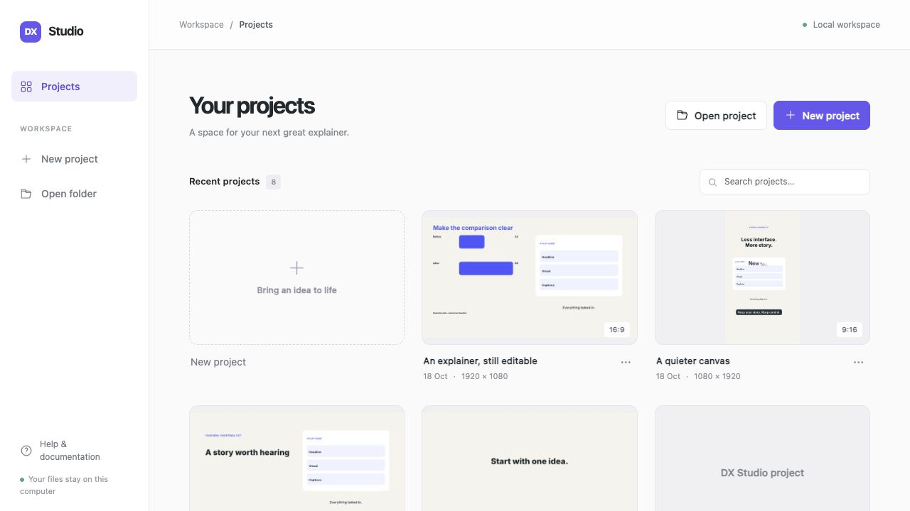
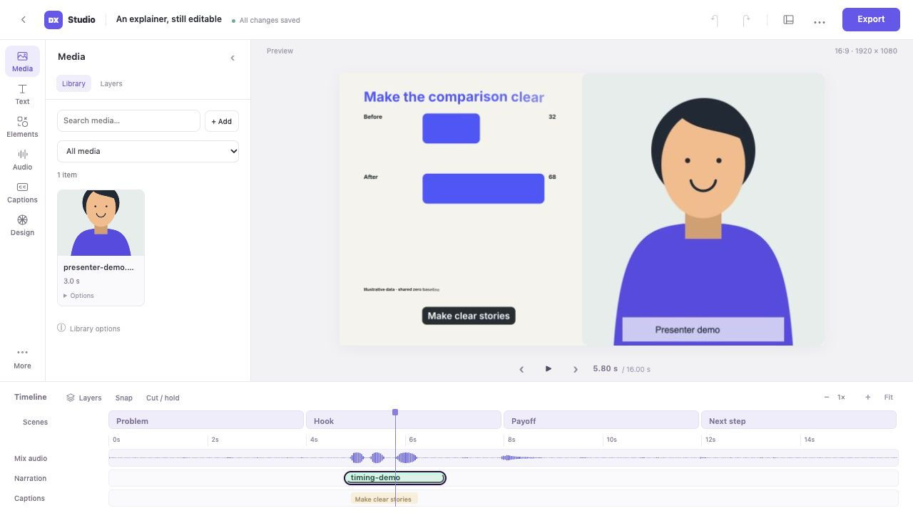
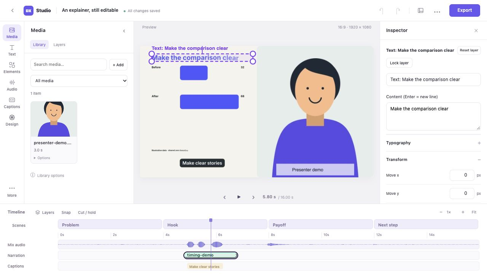

# A calmer editing workspace

The current development editor uses a light, compact layout with a project-focused
dashboard, a tool browser, a large preview and a timeline. It has no chat or prompt
panel. Existing project files, saved edits and export behavior continue to work.

## Projects first

The dashboard shows recent projects as preview cards. Click a preview or project
name to open it. Search matches names and folder paths. The card's options menu
contains **Remove from recent**; this keeps the project files.

**New project** opens a small dialog with a name and 16:9/9:16 canvas choice.
Expand **Project setup** for template, presenter space and destination folder.
**Open project** accepts the path to an existing trusted project. Setup forms stay
out of the dashboard until requested.

## Find a tool

| Left rail | Tools inside |
| --- | --- |
| Media | Thumbnail library, imports and searchable Layers. Asset options include replacement and relinking. |
| Text | Text for the current storyboard scene, plus Add text. Expand More project text for other fields. |
| Elements | Editable explanation blocks, selection templates and Add shape. |
| Audio | Voice recordings and the audio mix. |
| Captions | Caption list/text editing and Transcript. Expand Import & export or Timing & highlight when needed. |
| Design | Brand, colours, global layout and presenter recording/layout controls. |
| More | Storyboard, timing, scene settings, revision handoff, export and any custom-scene tools. |

There is no long row of workspace tabs. Each tool shows only its own subnavigation.
Informational notes can be expanded under **About this tool**.

## Select to inspect

Click a canvas layer, a layer track, or a row in **Media → Layers**. Its controls
appear in the right inspector while the media browser stays available on wider
screens. Content and transforms are immediately accessible. Typography, timing,
keyframes, entrances/exits, arrangement and alignment use collapsible sections.
The inspector's close button clears the layer selection.

On narrower desktops, selecting a layer temporarily replaces the left browser
with the inspector, keeping the preview visible. Close the inspector or choose
another rail tool to return to browsing. This first layout targets desktop editing;
very narrow screens still need a wider window for the full timeline.

## Expand the timeline only when needed

Scenes, the mix waveform, narration and captions are visible initially. Click
**Layers** in the timeline toolbar to expose individual graphics tracks and beat
markers. Click **Scenes** to open storyboard organization. **Cut / hold** opens the
existing ripple controls. Snap, zoom and Fit remain beside the timeline.

Playback and frame-step controls sit beneath the preview. The keyboard shortcuts
still work. View options control panel size, preview quality and canvas/timeline
focus. Safe-zone guides are available under **Design → Layout** and stay out of
exports.

## Save and export

Autosave status stays beside the project name. Undo and redo are in the header.
The header's **Project menu (···)** contains Save now, Version history, the last
export and Reset to original. Saving, recovery and stale-save protection are
unchanged.

**Export** opens the export settings in the tool browser. Choose your profile,
caption mode and optional range, then **Build this export**. A separate progress
window shows the job and its completed video. Export settings remain saved with
the project; the interface does not silently change existing delivery settings.
