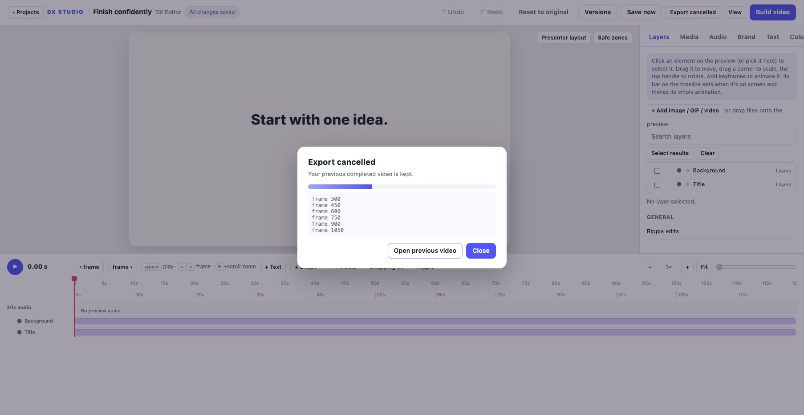
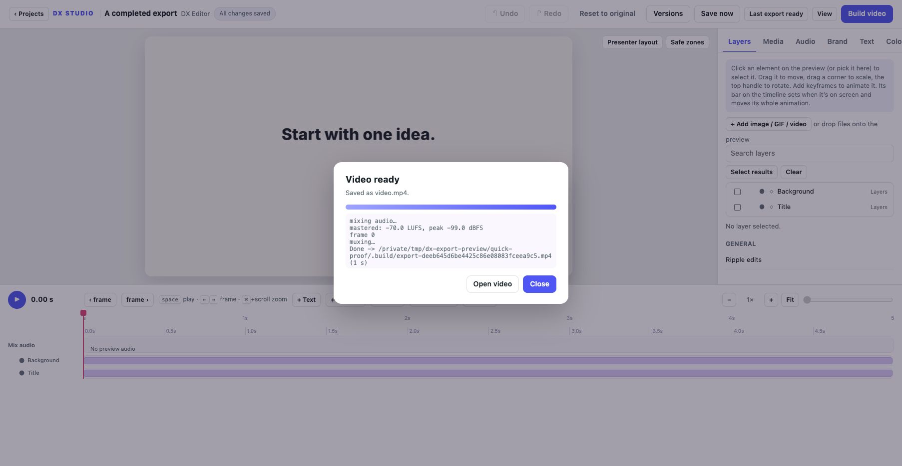

# Export jobs

Available in the development source toward v0.5.0.

**Build video** saves the current settings, runs file/caption preflight and starts
an export. The job captures those saved editor settings. Further edits can be
saved while it runs without changing that settings snapshot.

Choose **Keep editing** to leave the progress panel. **Export progress** reopens
the active job, including after a browser reload while the local server remains
running. A completed job appears as **Last export ready**. The progress panel
shows whether it is preparing audio, rendering frames or finishing the MP4.
Export details contain the underlying logs for troubleshooting.

## Cancel without losing a completed video

**Cancel export** stops the job's process group, including its encoder processes.
Cancellation targets the displayed job ID, so a stale page cannot accidentally
cancel a different job. One job can run per project in a running editor server.
A cancelled or failed job keeps the previous completed MP4, with a link to open
it. The project and its saved edits are preserved.

Successful jobs publish the complete MP4 with an atomic file replacement. The
CLI also uses isolated audio/video intermediates and only replaces its target
after encoding and muxing succeed. Preview audio and exports do not share a
partially written mix. Media caches use writer locks and publish completed frames
and audio atomically, so concurrent preview/export readers do not use incomplete
cache output.

The editor reports when newer edits have been saved since a completed export.
Rebuild to include them. Normal editor shutdown cancels active jobs. This is not
resumable rendering after a server restart; interrupted disposable files may
remain in `.build`. Source code and source files should stay stable while a job
uses them; the captured snapshot covers editor settings.

## Command-line output

```sh
dx-studio build projects/my-video
dx-studio build projects/my-video --output exports/review.mp4
```

Custom output paths must stay inside the project, use `.mp4`, and must not replace
a referenced media/audio source. Parent folders are created when needed. Advanced
workflows can pass `--settings` with a settings snapshot inside the project.
Output profiles, range exports and render queues remain planned.




