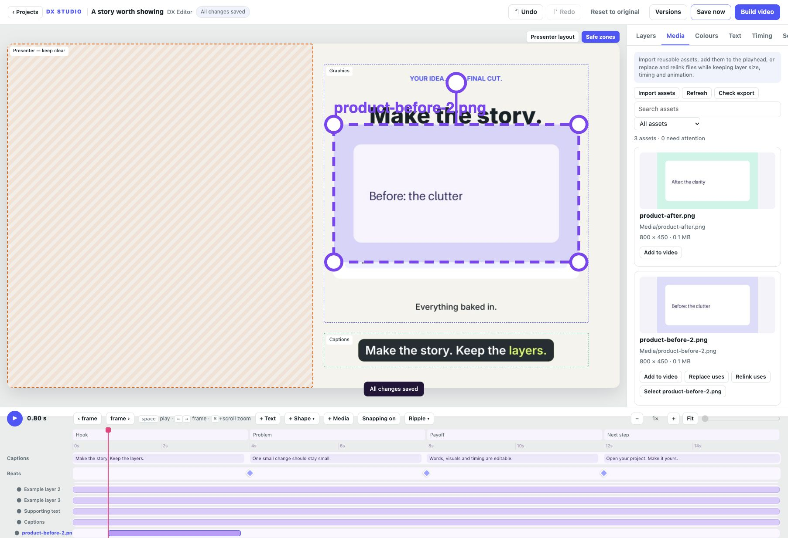

# Media library and file checks

Available in the development source toward v0.5.0.

Open **Media** to browse images, GIFs and footage inside the project's assets
folder. Search filenames and paths, or filter by type, usage or files needing
attention. Cards show thumbnails, resolution, duration for animated media,
file size and whether footage contains audio. Refresh after moving files outside
the editor. The library lists up to 1,000 discovered assets plus all referenced
sources; it does not scan the rest of your computer.

**Import assets** copies files into the project without adding layers. **Add to
video** inserts an editable layer at the playhead. New assets are sized and
centred in the graphics safe zone; dropping onto the canvas uses the drop point.
Supported sources: PNG, JPG, WEBP, GIF, MP4, MOV, M4V and WEBM. Imports are limited
to 256 MB per file in the local editor.

## Replace or relink

Use **Replace file** or **Relink file** in a selected media layer's inspector.
In Media, **Replace uses** and **Relink uses** update all unlocked layers sharing
that source. Locked layers are skipped. Select a replacement through the file
picker, or paste the full local path in the relink dialog. The file is copied
into the project so the result stays portable; original sources are retained.

Replacement keeps the stable layer ID, box, timing, transform, keyframes,
visibility, volume and entrance/exit. Undo, recovery and saved setting versions
continue to work. The source's name, type and audio availability update.
Different aspect ratios keep the existing box and may stretch; resize it if
needed. Video and audio caches follow source identity, so replacements cannot
reuse the old footage under the same layer ID.

Files are retained even if unused, including sources needed by earlier versions.
There is no automatic cleanup or folder-wide relink in this increment. This
library manages imported media layers. Custom Python scenes may use their own
asset paths; narration and music still use project.json.

## Check before export

**Check export** checks referenced overlay sources and configured narration/music
files. Missing or unreadable visible overlays block export with affected-layer
links and suggested fixes. Hidden missing overlays produce warnings. The editor
shows a placeholder for unavailable overlays so you can keep editing and relink.
Build video and the command-line `build` and `check` commands enforce the same
file check before audio mixing or rendering begins.

This is a file availability check, not a complete production preflight. It does
not analyse every video frame, custom scene assets, text overflow, all caption
issues or final audio levels.

