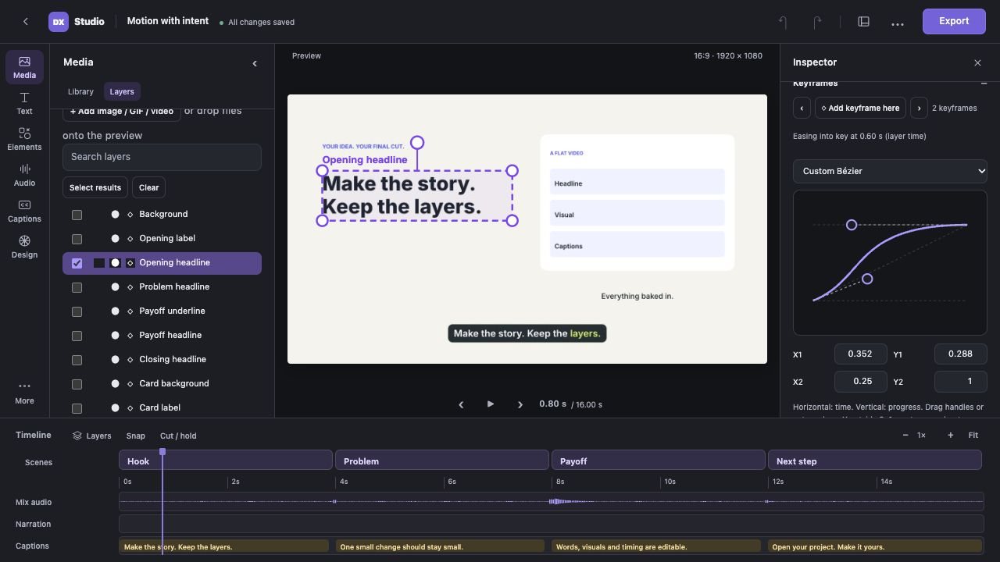

# Motion styles and easing curves

Available in DX Studio v1.0. Select a layer to open its
inspector. **Motion styles**, **Keyframes** and **Entrance & exit** stay folded
until needed; the workspace keeps its compact layout in light and dark mode.

## Reuse a reveal

Open **Motion styles** and choose Gentle rise, Editorial slide, Soft zoom,
Pop emphasis or Calm fade. Set the animation duration, then **Apply to selection**.
This replaces the selected layers' keyframes and entrance/exit settings. Their
static position, scale, rotation, opacity, content and on-screen windows remain.
Undo restores the previous motion. The scene's own Python animation still runs.

Select several layers through **Media → Layers** to apply one style together.
**Motion stagger** delays each successive selected root layer's animation.
Parents and their selected children are handled once; locked layers and children
of locked parents are skipped. The combined duration/delay must fit each layer's
window, or the operation is rejected before applying changes. Stagger does not
move the window, word anchors, narration or SFX. A style with a transparent first
key keeps a delayed layer hidden until its reveal; other styles hold their first
pose until the animation starts. Exits remain at the layer's end.

**Reduced motion: keep fades only** removes positional, rotation and scale changes
from the applied style, retaining its opacity animation and replacing spatial
entrance/exit presets with fades. It affects this application; it does not disable
arbitrary camera or motion code already drawn by the scene.

## Shape the timing

Open **Keyframes** after applying a style or making at least two keys. The curve
controls the transition into the next key at/after the playhead (or the final key
when the playhead is later). The destination key owns the curve. All five user
transform channels share it; this is a progress curve rather than a separate
value graph for every property.

Choose a named easing to see its shape, or **Custom Bézier** to edit two handles.
Drag a handle or focus it and use arrow keys; Shift increases the keyboard step.
X1/Y1/X2/Y2 fields provide precise controls. X stays in 0–1 for a valid time curve;
Y can range from −2 to 3 for anticipation or overshoot. Scale stays positive and
opacity stays within 0–1 during interpolation. Preview transforms, hit outlines
and final rendering use the same curve evaluation.

## Save a channel style

Select exactly one layer and expand **Save and share styles**. Name it and choose
**Save selected layer's motion**. The local library keeps up to 100 saved styles
alongside the included styles. Saved styles capture keyframes relative to the
layer's static transform: position/rotation offsets and scale/opacity ratios.
Key times normalize between the first and last key. Entrance/exit timing is saved
as fractions of that duration; the layer's window and entrance delay are excluded.
Capturing needs positive static scale/opacity and either two keys or an entrance/exit.

Apply the saved style to another layer without inheriting the original layer's
absolute placement or content. Pixel offsets retain their pixel size; review
fit and readability when changing canvas format. Export/import JSON to share a
style. Removing a saved style leaves motion already applied to projects intact.

Motion edits travel in project settings and portable selection templates. Custom
curves and entrance delays require the current engine; use the matching engine
included by `dx-studio pack` when handing off a project. Ordinary saved edits,
autosave, versions and undo continue to work.
