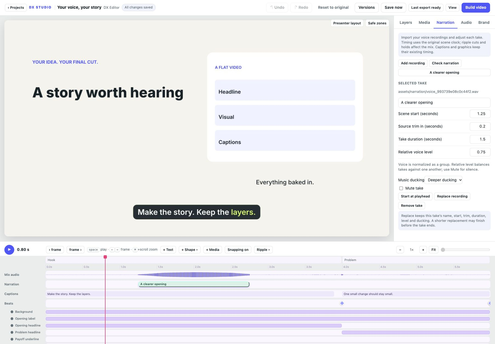

# Make the narration fit

Open **Narration** to import a voice recording at the playhead. Choose an audio
file or paste its full local path. DX Studio decodes supported recordings to a
48 kHz mono WAV and copies them into the project. An import does not move any
captions or graphics. The source file outside the project stays untouched.

Select a take in the panel or click its green timeline block. Rename it, set its
scene start, trim unwanted audio from the beginning with **Source trim in**, and
choose how long it plays. Timing is in the original scene clock; ripple cuts
remove the corresponding audio and inserted holds are silent. Multiple takes
can overlap. The mix waveform shows the resulting output audio.

**Relative voice level** balances takes against one another. Narration is
normalized as a group, so lowering the only take is not an absolute volume
control. **Mute take** silences it. Muted and zero-level takes do not duck music.
Choose normal, deeper or no music ducking for each active take.

**Replace recording** changes the audio source while retaining the take's ID,
name, start, trim, duration, level, mute and ducking. Review a shorter replacement:
only available source samples play. A take that extends past the scene is
clipped at export; **Check narration** warns about this. A missing source or a
trim wholly outside the source needs replacement, a timing fix or muting before
export. Captions, graphics and word timings do not realign automatically.

Changes use normal undo, autosave, recovery and named settings versions. Removing
a take keeps its audio file. Portable project bundles include those files and
saved edits, allowing old versions and source replacements to remain usable.

The existing **Audio** panel remains a preview listening workspace; its monitor
volume and audition range do not change exports. In-browser microphone recording,
transcription, word alignment and draggable narration trims are future work.

Speech-authoring scripts and `VoiceTimes` still use `project.json.voice`. An
assistant updating the script should inspect saved `__voice` overrides too.
Updating the original voice list does not automatically replace editor takes.

