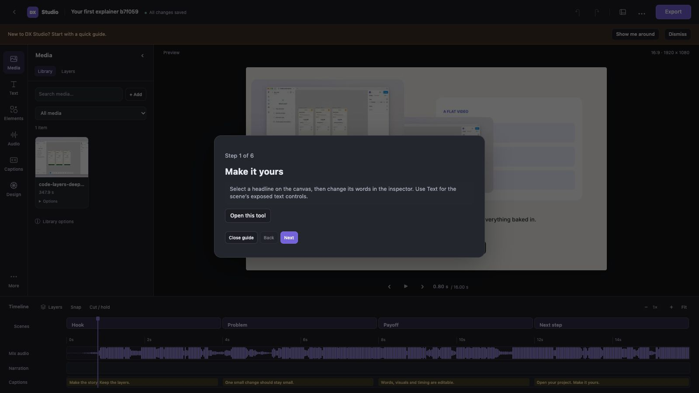

# Your first explainer

After [installation](INSTALL.md), run the launcher and open the dashboard.

1. Choose **Try a sample** for an editable 16-second explainer, or **New project**
   to choose 16:9/9:16, a template and optional presenter space. The sample has
   original graphics and synthesized sound; no voice model or account is needed.
2. In **Text**, change the opening headline. Click a canvas layer to move, scale,
   hide or retime it in the inspector. Use Undo to compare your change.
3. In **Media**, add your images or footage. In **Audio → Voice**, add your recorded
   narration. Files are copied into the project; captions do not change automatically.
4. Correct caption words/timings in **Captions**. Use **Design → Layout** for a
   presenter reservation and the safe-zone button above the canvas for guides.
5. Wait for **All changes saved**. Use **Project menu → Version history** to name
   a cut before a bigger change. Browser draft recovery appears if an earlier
   save did not finish. Versions contain settings, not source-code backups.
6. Open **Export**. Choose filename, resolution, fps and caption mode. **Check source
   files**, then **Build this export**. Open the completed video and review the
   beginning, transitions, captions, voice sync and end before publishing.

The six-step in-editor guide can be reopened from the Project menu. Its banner
can be dismissed; it does not change your project.

## Start with Claude, ChatGPT or a coding assistant

Give your assistant the release's `dx-studio-video.zip` or repository `SKILL.md`.
It needs a coding environment to execute Python and inspect rendered images.
Ask for an editable project and state the audience, format, length, recordings
and presenter space. Example:

> Create a 45-second 9:16 explainer about how password managers work. Use my
> recording for narration, keep graphics horizontally centred, and leave the
> bottom-right corner for a talking head. Deliver editable layers, an MP4 and a
> portable DX Studio project.

Extract its portable project and follow `OPEN-ME.md` to install the included
engine. In DX Editor choose **Open project** and paste the extracted `project/`
folder path. Scene code executes Python; use projects from people you trust.
A text-only chat can draft source but cannot verify an actual render.

## Move or back up your work

Use **Project menu → Download portable project**. Current saved edits, source
files, fonts and the matching engine are included. Enable older settings versions
for a backup; leave this off for a normal handoff. Check unused/private source
files and licences before sharing. Output MP4s and caches are excluded; share a
finished MP4 separately.

If sources go missing, use **Media → Library options → Find missing files in folder**.
Review unique matches before copying them back. Ambiguous names require individual
relinking or a more specific source folder. See [MEDIA](MEDIA.md).
