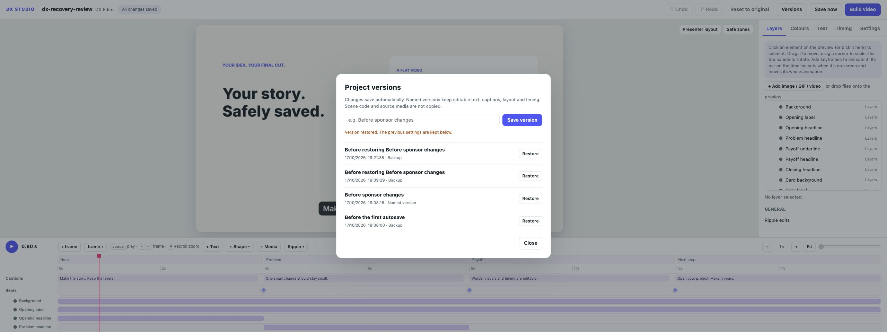

# Autosave, recovery and versions

This page describes development work for the next release. The published v0.1.0
editor still uses manual Save. Use the feature branch to try these controls.

## Everyday saving

Edits save to the project's `settings.json` about one second after editing pauses.
The header distinguishes waiting, saving, saved and failed states. **Save now** or
Cmd/Ctrl+S flushes pending changes, including while typing in a text field. The
CLI and portable bundles use these saved settings as before.

A save captures a copy of the values being sent. If you edit while it is in
flight, the newer state is sent afterward. Failed saves retry; they never receive
an “All changes saved” badge. Audio preview regeneration is delayed until editing
settles so every keystroke does not immediately launch a mix.

## Named versions

Choose **Versions**, give the current cut a name and click **Save version**.
Restore a version from the list to return to its editable settings. Restoring or
resetting first keeps a backup of the current saved settings. Undo/redo remain
available for in-session changes.

Versions live in `.dx-studio/versions` inside the project. They preserve editable
parameters, captions, layer transforms/visibility/keyframes, added-media
references and timeline edits. They do **not** copy scene code, project.json,
voice recordings or media files. Keep those source files if a version needs them.
If the scene/configuration/caption source changed, the editor warns before
restoring matching settings against the current scene.

Before the first changed save, the initial settings are backed up. Later saves
keep at most one automatic backup per minute and retain the latest 30 automatic
backups. The initial backup, named versions and restore/reset backups are not
removed automatically. There is no version-deletion UI yet. Local history is not
included in portable project bundles; the current saved settings are included.

## Recover edits that did not reach disk

While editing, a pending copy is also written to this browser's local storage.
On reopening, **Review drafts** offers recover, download and discard controls.
Nothing is recovered over the saved project without your action. Recovery keeps
a version of the current saved settings before applying the draft.

Each tab keeps its own draft. Browser drafts are specific to the project and
browser origin (including the editor port). Use the same browser/profile and port
when recovering; moving the project folder changes its recovery key. Clearing site data, private browsing restrictions, storage limits
or browser failure can remove or prevent recovery copies. The header tooltip
indicates unavailable recovery storage; wait for a successful disk save before
closing. Once settings have saved to disk, reopening does not depend on browser
storage or the port.

## Another window or application changed the project

Version-aware saves compare the disk revision with the revision the tab last
acknowledged. Writes from editor processes are serialised using a project-local
file lock. A stale save pauses with a conflict instead of replacing newer work.
**Reload saved project** loads the current disk settings; your pending draft stays
available for explicit review afterward. Download a draft if you want to compare
or preserve it separately.

This is overwrite protection, not collaborative editing or an automatic merge.
Previews are shared by a single local editor server. External tools that write
settings.json do not participate in the editor lock; their completed changes are
detected on the next revision check. Legacy flat save requests remain compatible
but do not provide the new client revision check.

## Verification

Regression coverage includes reopen/render parity, caption/layer preservation,
restore backups, stale and simultaneous writers, interrupted atomic replacement,
bounded automatic backups, private history exclusion from bundles and HTTP input
checks. Browser-independent JavaScript tests cover debounced autosave, in-flight
edits, failure/retry, conflicts, independent drafts, reopen discovery and unavailable
browser storage. They run through pytest when Node is available; rendering and
normal use do not need Node.

Visual verification used disposable projects: an edit autosaved without pressing
Save, a named version restored with a retained backup, and a deliberately rejected
save left a browser draft that was recovered after closing and reopening a tab.
