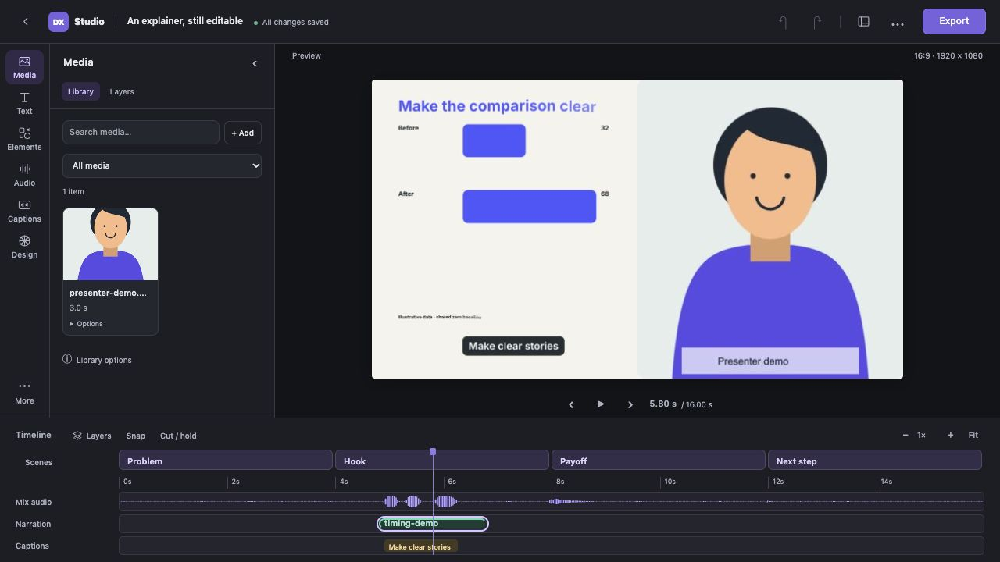

# Workspace appearance, layouts and preview quality

Available in the development source toward v0.5.0.

Choose **Appearance → System, Light or Dark** in the dashboard header or the
editor's **View options** dialog. **System** is the default and follows device
appearance changes while the workspace is open. Light and Dark stay selected
until you change the preference. The choice is saved in this browser and shared
across the dashboard, projects and open tabs on the same editor address.

Appearance changes the interface, including dialogs and timeline tracks. It does
not recolour video frames, brand colours or exports, and does not mark a project
as edited. If browser storage is unavailable, switching still works for the
current page; a new page returns to System.

Open the header’s **View options** icon to make room for the task at hand:

- **Balanced layout** restores the standard tool-panel and layer-track sizes.
- **Focus canvas** hides tool panels and the timeline grid, keeping playback controls.
- **Focus timeline** expands a taller layer list with a narrower tool panel.

Drag the divider beside the left tool panel, or above the timeline after expanding Layers to resize. The
keyboard-accessible dividers also respond to Left/Right or Up/Down in ten-pixel
steps. View includes equivalent width/height sliders and show/hide controls.
Panel sizes are bounded by the window so the canvas retains space.

**Preview quality** offers Automatic, Fast, Balanced and Sharp. Fast requests
smaller render frames for easier playback on slower computers; Sharp requests
more pixels for paused inspection. A delayed rendering badge appears when a
paused preview takes longer to arrive. These settings do not change project
resolution or the final video export.

View preferences stay in this browser and are shared across projects on the
same local editor address. They survive reloads when browser storage is
available. They are separate from editable project settings and do not create
unsaved content changes. Open View options again to restore hidden panels.

