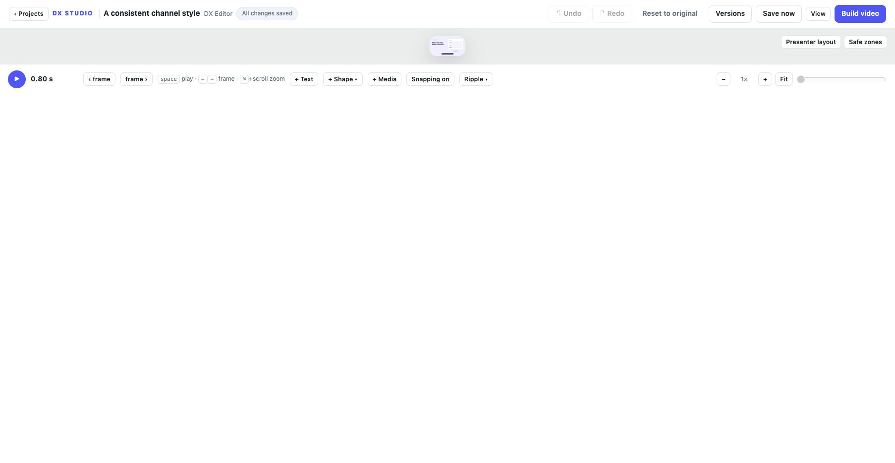

# Workspace layouts and preview quality

Available in the development source toward v0.5.0.

Open **View** to make room for the task at hand:

- **Balanced layout** restores the standard inspector and layer-list sizes.
- **Focus canvas** hides the inspector and timeline grid, keeping playback controls.
- **Focus timeline** shows a taller layer list with a narrower inspector.

Drag the divider beside the inspector or above the timeline to resize. The
keyboard-accessible dividers also respond to Left/Right or Up/Down in ten-pixel
steps. View includes equivalent width/height sliders and show/hide controls.
Panel sizes are bounded by the window so the canvas retains space.

**Preview quality** offers Automatic, Fast, Balanced and Sharp. Fast requests
smaller render frames for easier playback on slower computers; Sharp requests
more pixels for paused inspection. A delayed rendering badge appears when a
paused preview takes longer to arrive. These settings do not change project
resolution or the final video export.

View preferences stay in this browser and are shared across projects on the
same local editor address. They survive reloads when browser storage is
available. They are separate from editable project settings and do not create
unsaved content changes. Open View again to restore hidden panels.

