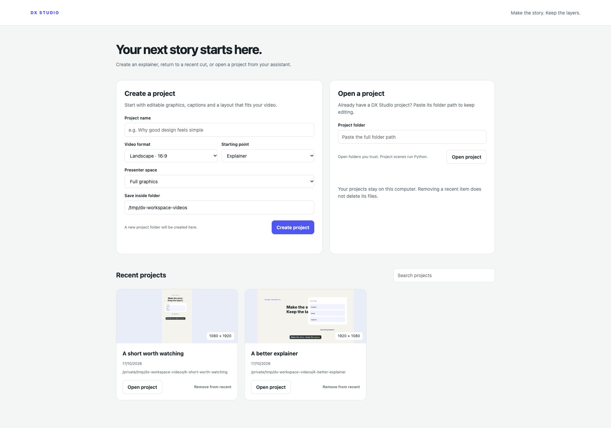
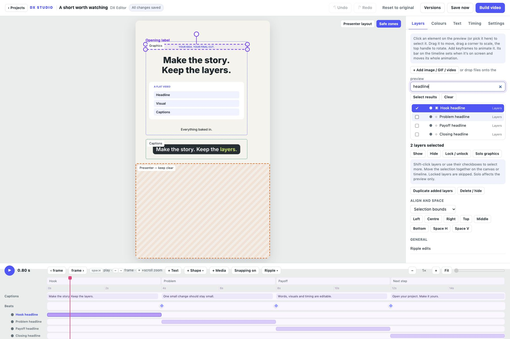

# Projects and layer controls

These features are available in the development source toward v0.5.0. They are
not part of the published v0.1.0 downloads.

## Start with a project

Run `dx-studio edit` to open the project home. Give the project a name, choose
16:9 or 9:16, pick an explainer or minimal starter, and reserve presenter space
if needed. Paste the parent folder where the new project should be saved.
Existing folders are never overwritten.

To continue an assistant-created video, paste its project folder in **Open a
project**. Open trusted projects: scene files run Python. Search recent projects
by name or path. Removing a recent item only removes its entry, keeping all files.
Missing folders are marked so you can find and open their new location.

Use **‹ Projects** in the editor to save pending changes and return home. Each
project has a separate URL, browser recovery draft, history, media and saved
settings. Opening the same project in two tabs still uses stale-save protection.
The library stores paths and metadata locally. Browsing recents does not execute
scene code; thumbnails for unopened projects use a previously cached preview.

## Work with layers together

In **Layers**, search by label, ID or group. Matching children retain parent
context. Use the checkboxes or Shift/Ctrl/Command-click to select several layers.
**Select results** or Ctrl/Command+A selects the unlocked search results.
**Clear** clears the selection. Renaming changes the display label and keeps
stable IDs used by scene code.

Move selected layers together on the canvas or drag their timeline bars. Selecting
both a parent and its child moves the hierarchy once. Arrow nudges use the same
selection; hold Alt for nudging, with Shift for ten pixels. Bulk actions can show,
hide, lock, duplicate added text/shapes/media, or delete added layers. Scene-defined
layers are hidden instead of removed from source.

A locked layer stays visible but cannot be moved, retimed or changed with its
layer controls. A locked parent protects its children; unlock the parent first.
Locks protect editor gestures, not global scene parameters or changes to Python
source. **Solo graphics** isolates selected graphics in the preview. **Exit solo**
returns to the whole composition. Solo is temporary and does not change exports.

## Compose deliberately

Choose the alignment reference: selection bounds, full frame or graphics safe
zone. Align left, centre, right, top, middle or bottom. For one selected layer,
selection bounds falls back to the full frame. **Space H/V** distributes at least
three visible layers with equal gaps. The playhead must show all selected layers.
A single layer also has **Fit graphics safe zone**, which scales and centres it
inside the reserved graphics area.

**Snapping on/off** (S) controls timeline and canvas snapping. Hold Alt during a
drag to temporarily disable snapping. Undo/redo and autosave apply to these edits.
See [saving and recovery](SAVING.md) for restore and version controls.

