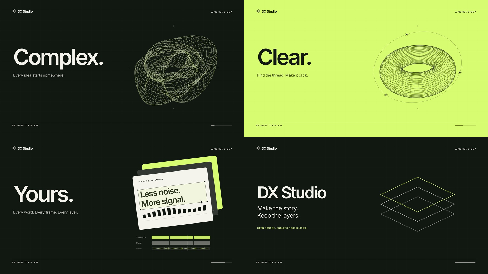

# Make it click

An original ten-second DX Studio motion study, composed separately for
**1920 × 1080** and **1080 × 1920**, at 30 fps. The downloadable MP4s include an
original electronic score and tactile, layer-linked sound effects.

[Watch landscape](https://github.com/joyjophin/dx-studio/releases/download/v1.0.0/make-it-click-landscape.mp4) ·
[Watch portrait](https://github.com/joyjophin/dx-studio/releases/download/v1.0.0/make-it-click-portrait.mp4)



## The ten seconds

| Time | Story | Motion / sound |
| --- | --- | --- |
| 0–2.25 s | **Complex.** Every idea starts somewhere. | A deformed toroidal ribbon mesh rotates briefly, then settles. Round bass and damped glass partials establish the rhythm. |
| 2.25–4.5 s | **Clear.** Find the thread. Make it click. | A directional citron matte inverts the type and fine lines exactly at its edge. The mesh resolves and a single orbit traces around it. |
| 4.5–7.6 s | **Yours.** Every word. Every frame. Every layer. | Three offset poster planes land with staggered taps. Typography gains selection handles; track graphics and a pointer demonstrate the idea of editability. |
| 7.6–10 s | **DX Studio.** Make the story. Keep the layers. | The poster recedes into a three-plane signature. A final chord resolves, followed by a quiet reading hold. |

The palette is ink, ivory and citron. Tight DX Sans typography, a fine engineering
grid, consistent margins and one geometric motif connect the sequence. No stock
artwork, private stickers, external typefaces, recorded samples or generated footage.

Portrait is a fresh vertical arrangement with its sculpture centred at x=540.
The native content area has equal 130 px side margins, and the headline and support
share the sculpture’s horizontal centre. Landscape uses a two-column
composition. Since the film has no speech or captions, graphics use the entire
available content height. Adding captions reserves their band and draws them through
the normal DX Studio caption system. Presenter presets also reflow the composition;
review the result before exporting, especially after manual layer transforms.

## Open and customise

Download a portable project bundle, extract it, and follow its **OPEN-ME.md**:

- [Landscape editable project](https://github.com/joyjophin/dx-studio/releases/download/v1.0.0/make-it-click-landscape-project.zip)
- [Portrait editable project](https://github.com/joyjophin/dx-studio/releases/download/v1.0.0/make-it-click-portrait-project.zip)

Each includes the matching DX Studio 1.0.0 engine, original score, scene source,
current saved settings when present, licences and an integrity manifest.

In the editor:

- **Text:** change the headlines, supporting copy, brand signature and poster type.
- **Design:** change Ink, Ivory and Citron. The artwork derives its colours from them.
- **Media → Layers:** move, scale, hide or retime the sculpture, planes, typography,
  tracks and signature. Expand **Ivory poster** for its child layers. Transforming
  the parent carries its contents; the children remain individually editable.
- **Captions:** optionally add timed captions; the empty band is not reserved until needed.
- **Audio:** adjust the score and linked effects independently. Replace the original
  score asset in a copy of the project when changing the sound direction.

The track graphics inside the film are an illustration, not an editor recording.
The README's editor and dashboard screenshots are actual UI captures. The headline
comparison GIF holds two genuine editor states for easy comparison.

## Render from source

From a clone of the current repository, after [installation](../../docs/INSTALL.md):

```sh
python scripts/render_showcase.py --stills
python -m dx_studio edit outputs/showcase/landscape
python -m dx_studio edit outputs/showcase/portrait
```

For final MP4s and gallery assets:

```sh
python scripts/render_showcase.py --output outputs/showcase-final --build --stills --gallery
```

This creates both self-contained projects, a deterministic 48 kHz / 24-bit FLAC
score, native review frames, verified H.264/AAC masters, 15 fps GIF previews,
posters, a format comparison and a four-beat storyboard. No network access is used.
The script refuses to overwrite a generated project with non-empty saved edits;
choose a fresh `--output` when making another cut.

To rebuild gallery art from existing finished projects without recreating them:

```sh
python scripts/render_showcase.py --output outputs/showcase-final --gallery
```

The optional gallery pass writes to `docs/images` by default. Use
`--gallery-output outputs/gallery` to keep an experiment separate. Browser captures
are made separately in the actual editor; they are never reconstructed with code.

## Source and credits

- [scene.py](scene.py): geometry, editable schema, analytical animation and named layers.
- [render_showcase.py](../../scripts/render_showcase.py): project creation, original
  score synthesis, rendering and gallery production.
- Code, original graphics and original audio: [MIT](../../LICENSE).
- Bundled DX Sans font outlines: [SIL OFL 1.1](../../dx_studio/fonts/OFL.txt).

The videos are silent in voiceover terms: the MP4 soundtrack is music and effects,
so a separate duplicate “no voice” export is unnecessary. The GIFs have no audio.
